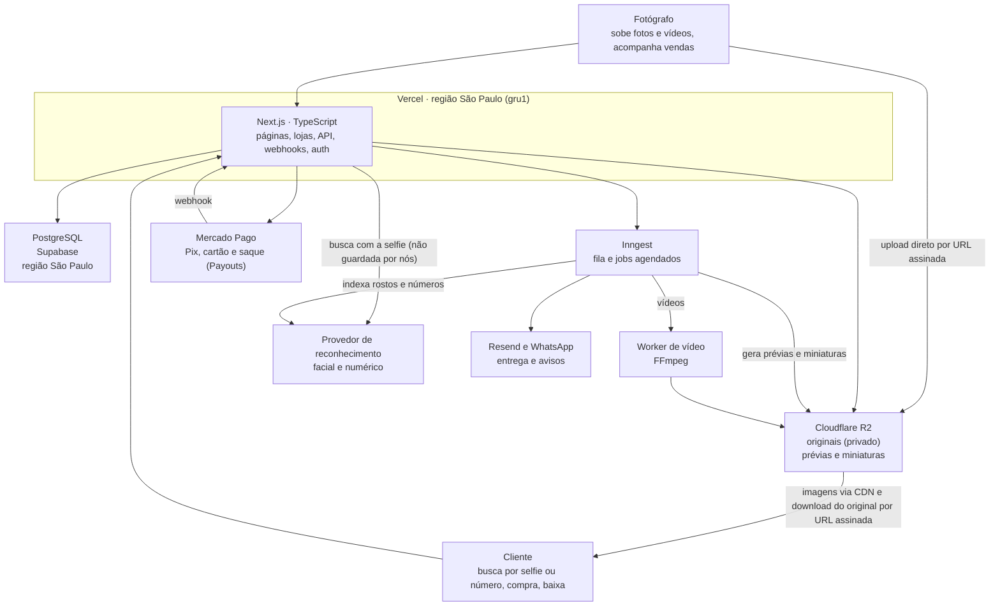

# Arquitetura — Plataforma de Venda de Fotos

Oct 6, 2026 · @gabriel

## Visão geral

Um marketplace onde fotógrafos sobem fotos e vídeos de eventos e clientes encontram e compram os seus, pela selfie, pelo número de peito ou navegando na galeria. O cliente paga na conta da plataforma; o fotógrafo saca pelo painel, e a comissão da plataforma sai no saque.

A referência de produto é a Fotto, resumida em [referencias/fotto.md](referencias/fotto.md). Ela orienta as decisões, mas não as fecha sozinha.

**Premissas adotadas:**

- Foco em fotos e vídeos de eventos (corridas, festas, formaturas, esportes), vendidos por item ou em pacote.
- Mercado brasileiro: preços em reais, pagamento por Pix e cartão, dados hospedados no Brasil.
- Fotos em JPEG, PNG, WebP, TIFF ou AVIF, entregues ao comprador no formato enviado, sem limite de tamanho além do teto técnico de 200 MB; HEIC/HEIF é convertido em JPEG no navegador antes do envio. RAW não é aceito: o fotógrafo exporta a foto final antes de enviar. Vídeos em MP4 ou MOV (até 500 MB e 5 minutos).

**Escopo do MVP:**

- Cadastro e login de fotógrafos e clientes; compra sem cadastro
- Fotógrafo cria um evento e sobe fotos e vídeos em lote
- Prévia com marca d'água e miniatura geradas automaticamente, para foto e vídeo
- Busca por reconhecimento facial (selfie) e numérico (número de peito), filtro por horário e lista de fotos não identificadas
- Galeria pública por evento, com pastas, ordenação, visibilidade (pública, não listada ou com senha) e liberação automática, manual ou agendada
- Carrinho com itens de vários eventos, checkout com Pix/cartão e download do original após o pagamento
- Descontos: cupons, desconto progressivo e pacote "todas as minhas fotos"
- Entrega automática por e-mail e por WhatsApp; recuperação de carrinho abandonado
- Fotógrafos colaboradores no mesmo evento, com divisão da venda
- Loja própria do fotógrafo, com nome, logo, cores e domínio
- Denúncia de evento ou foto, com moderação pela equipe
- Painel do fotógrafo com vendas, saldo e saque por Pix (normal em 30 dias ou antecipado em 1 dia)

**Fora do MVP:** app mobile, plugin do Lightroom, upload em tempo real, desfoque contra print, marca d'água personalizada, planos pagos para fotógrafos e os demais itens listados em [referencias/fotto.md](referencias/fotto.md#o-que-adotamos-no-mvp).

## Stack técnica

TypeScript de ponta a ponta, com Next.js no front e no back, PostgreSQL para os dados e Cloudflare R2 para os arquivos.

| Camada | Escolha | Por quê |
|---|---|---|
| Linguagem | TypeScript | Uma linguagem só no front e no back |
| Framework web | Next.js (App Router) | Páginas com SEO, API e webhooks no mesmo projeto |
| Banco de dados | PostgreSQL | Dados relacionais e transações seguras para pedidos e pagamentos |
| Acesso ao banco | Drizzle ORM | Leve, tipado e próximo do SQL |
| Arquivos | Cloudflare R2 | Compatível com S3 e sem custo de transferência de saída |
| Processamento de imagem | Sharp | Gera miniaturas e prévias com marca d'água |
| Processamento de vídeo | FFmpeg num worker separado | Prévia com marca d'água, capa e quadros para o reconhecimento; não cabe nas funções da Vercel |
| Reconhecimento facial e numérico | Amazon Rekognition (facial); provedor de OCR a decidir (números) | Indexa rostos das fotos numa coleção por evento e compara com a selfie, que nós não guardamos; a retenção pela AWS só fica desligada com o opt-out de serviços de IA ([seguranca.md](seguranca.md), item 20) |
| Fila de tarefas | Inngest | Processa uploads e roda os jobs agendados sem manter servidor de fila |
| Autenticação | Login com Google (OAuth 2.0 com PKCE) e e-mail e senha, sessão própria; Better Auth avaliado na Fase 11 | Usuários e sessões no nosso banco; papéis cliente, fotógrafo e gestor |
| Pagamento | Mercado Pago (Checkout Transparente via Orders + Payouts) | Pix e cartão dentro do site; saque do fotógrafo por Pix pela API |
| Interface | Tailwind CSS + shadcn/ui | Componentes prontos e fáceis de customizar |
| E-mail | Resend | Código de confirmação do cadastro, "Esqueci a senha", confirmação de compra, links de download e carrinho abandonado |
| WhatsApp | API oficial do WhatsApp (Cloud API ou parceiro) | Entrega automática do link de download |

## Componentes e deploy

O Next.js na Vercel é o centro: ele fala com o banco, a fila, o storage, o gateway e o provedor de reconhecimento. Os arquivos pesados nunca passam por ele.



O fotógrafo envia os arquivos direto ao R2; o cliente recebe prévias pela CDN e o original por um link temporário depois de pagar.

## Armazenamento das fotos e vídeos

Cada foto vira três arquivos no R2 e cada vídeo vira três ou quatro, separados em dois buckets: um privado para os originais e um público para o que aparece no site. O banco guarda só as chaves desses arquivos.

| Versão | Bucket | Tamanho aproximado | Uso |
|---|---|---|---|
| Original (foto) | `fotos-originais` (privado) | JPEG, PNG, WebP, TIFF ou AVIF, de 1 a 200 MB, no formato enviado (a chave leva a extensão do formato real) | Entregue só ao comprador, por URL assinada, com o tipo e a extensão do formato |
| Original (vídeo) | `fotos-originais` (privado) | MP4 ou MOV de até 500 MB | Entregue só ao comprador, por URL assinada |
| Prévia com marca d'água | `fotos-publicas` | Foto: 200 a 300 KB, 1600 px. Vídeo: 720p | Página do item e galeria ampliada |
| Miniatura | `fotos-publicas` | 30 a 50 KB, 400 px (no vídeo, um quadro de capa) | Grade da galeria |

**Padrão de nomes das chaves:**

```
envios/{fotografo_id}/{evento_id}/{foto_id}.jpg  # original chegando do navegador (privado, temporário)
originais/{fotografo_id}/{evento_id}/{foto_id}.{jpg|mp4|mov}
previas/{fotografo_id}/{evento_id}/{foto_id}-v{versao}.webp  # foto; no vídeo, {foto_id}.mp4
miniaturas/{fotografo_id}/{evento_id}/{foto_id}-v{versao}.webp
denuncias/{denuncia_id}/{arquivo_id}          # anexos, no bucket privado
```

- `fotos.chave_original` guarda a chave no bucket privado (`envios/...` enquanto a foto está em `processando`, `originais/...` depois). `fotos.url_previa` e `fotos.url_miniatura` guardam as chaves no bucket público, e o endereço é montado na leitura com `R2_URL_PUBLICA` (`src/lib/url-publica.ts`): trocar o `r2.dev` por um domínio próprio não mexe no banco. Os dados de exemplo guardam caminhos `/exemplo/previas/...` e `/exemplo/miniaturas/...`, que passam como estão.
- **Só prévia protegida chega ao navegador nas fotos e vídeos à venda (falha segura, 14/10/2026):** toda imagem de item à venda (miniatura, prévia, prévia do celular, prévia do vídeo; na galeria, na página da foto, na busca por selfie e por número, nos cartões com a capa automática ou a foto escolhida como capa e no `og:image`) passa por `urlDaPrevia` em `src/lib/url-publica.ts`, chamada por `paraFoto` (`src/dados/mapas.ts`) e pelas consultas que leem as colunas direto. Ela só monta a URL de chaves `previas/...` ou `miniaturas/...` do bucket público (ou de uma URL completa do próprio bucket); a foto que não está `pronta`, a chave do original (`originais/`), o upload temporário (`envios/`), `data:`, truque de caminho (`..`) e URL de qualquer outro domínio (Google Drive, googleusercontent etc.) viram o aviso `public/marca/processando.svg`, nunca o arquivo. Capa enviada pelo dono do evento, banner e logo da loja são imagens de divulgação, fora dessa regra: saem como foram enviadas, por `urlPublica`, que só recusa URL de domínio que não seja do R2. Testes que travam isso: `src/lib/url-publica.test.ts`, `src/dados/imagens-publicas.test.ts` (as funções das páginas públicas com o banco "estragado" por link do Drive e chave do original) e `src/lib/contrato-imagens.test.ts` (o código-fonte não monta link do Drive, não passa coluna de foto por `urlPublica` e só uma lista fechada de arquivos grava no bucket público).
- **Arquivos de fora do R2 (ex.: Google Drive):** hoje não existe integração com o Drive. Se uma for criada, o caminho é o mesmo do envio: o servidor (ou um job) baixa o arquivo do Drive para `originais/` no bucket privado, gera as versões com `gerarVersoes` (`src/servicos/imagens.ts`), grava em `previas/` e `miniaturas/` e serve só isso. O navegador nunca recebe link nem id utilizável do arquivo no Drive, e os arquivos não devem ficar compartilhados como "qualquer pessoa com o link". Um link do Drive gravado por engano em `fotos.url_previa` aparece como "Processando".
- O prefixo `envios/` tem regra de ciclo de vida no R2 que apaga o que ficar lá mais de 1 dia (envio abandonado ou recusado); o original só vai para `originais/` depois de conferido.
- **Versão da marca na chave:** a prévia e a miniatura levam no nome a versão do desenho da marca (`VERSAO_DA_MARCA` em `src/lib/marca-dagua.ts`; hoje `-v3`; as da versão 1 não têm sufixo). As duas são gravadas com cache `immutable`, então uma marca nova precisa de chave nova para furar o cache do navegador e da CDN. A versão na chave também é o que marca a foto como regerada: não há coluna nem migração para isso.

**Prévia e marca d'água**

A prévia (1600 px no lado maior, WebP 72), a prévia do celular (1000 px, WebP 70) e a miniatura (400 px) saem com o padrão diagonal de logos do ClicouAí gravado nos pixels, no modelo que o fotógrafo escolhe em Painel > Marca d'água (sete modelos em `src/lib/marca-dagua.ts`; o desenho em `src/servicos/imagens.ts`). O modelo **Proteção forte** (14/10/2026, no estilo de concorrentes que cobrem a pessoa) soma às logos e à grade anéis grandes no azul da marca (o maior sobre o centro, onde costuma estar a pessoa, para a IA ter de reinventar corpo e rosto), dois pontos em limão, a logo grande no meio, "Foto protegida" na vertical nas laterais e "Não tire print" numa caixa; os textos são PNG prontos em `public/marca/` (`scripts/gerar-textos-da-marca.ts`), porque o servidor não tem fontes. É opcional: quem prefere a prévia mais limpa fica nos outros. **Prévia do celular** (versão 4 da chave): a página da foto usa `<picture>` e, abaixo de 768 px de largura, baixa a versão de 1000 px (`-v4-celular.webp`, `chaveDaPreviaCelular`); na tela do telefone fica igual, e uma cópia limpa por IA sai pequena demais para imprimir. Subir para a versão 4 fez a regeração criar essa versão nas fotos já enviadas (vídeos e prévias antigas sem ela usam a prévia normal). Um cliente já conseguiu que um assistente de IA removesse a marca de uma prévia; em 11/10/2026 tentamos uma marca pesada (versão 2: prévia de 800 px, marca grande sobre os rostos, grade de texto, linhas e faixas) e no dia seguinte voltamos a este desenho, na versão 3 da chave, porque ela estragava a prévia para quem compra ([riscos.md](riscos.md), "Marca d'água removida com ferramentas de IA"). Da tentativa ficaram a galeria e a página da foto sem arrastar a imagem (`draggable=false`), sem menu de contexto ("Salvar imagem como...") e sem o menu do toque longo no iPhone (utilitário `imagem-protegida`), só contra o caso casual, e a regeração em lote abaixo, que troca a marca de todas as fotos sempre que a versão subir. Também contra o caso casual, as prévias ficam **desfocadas na hora do print** (`src/components/galeria/protecao-contra-print.tsx`, montado no layout público): o `<html>` ganha a classe `protegido` quando o navegador dá sinais de print (tecla PrintScreen, Win+Shift+S, Cmd+Shift+3/4/5, janela sem foco, aba em segundo plano, mouse fora da página) e `html.protegido .imagem-protegida` aplica `blur(18px)`; volta ao normal quando o foco ou o mouse voltam (ou 1,5 s depois de um atalho). O print pelo botão do celular, outro monitor, câmera ou gravação de tela passam: a página nem fica sabendo.

**Regeração das prévias antigas**

`src/servicos/regerar-previas.ts` regera, no servidor e a partir do original no bucket privado, a prévia e a miniatura das fotos cuja chave não tem o sufixo da versão atual (fotos prontas, não vídeos, inclusive as excluídas, porque quem comprou ainda vê a miniatura no pedido). Para cada foto: lê o original, gera as versões no modelo do dono do evento, grava nas chaves novas, troca as chaves no banco num UPDATE condicional (só se ainda estiverem as antigas) e só então apaga a prévia e a miniatura antigas do R2 (`removerPublico`, que só apaga `previas/` e `miniaturas/`). Seis fotos ao mesmo tempo, dentro do orçamento de memória do envio. Idempotente: a foto trocada sai da lista; duas chamadas ao mesmo tempo gravam o mesmo conteúdo nas mesmas chaves e só uma troca e apaga; se a função morrer no meio, a foto continua com a prévia antiga (que ainda existe) e volta na próxima chamada. O original nunca vai ao bucket público.

- **Rota:** `GET /api/jobs/regerar-previas?evento=<slug>&limite=600`, com `Authorization: Bearer CRON_SECRET` (mesma proteção dos outros jobs), `maxDuration` de 300 s, começa fotos novas até 240 s. Responde `{ regeradas, falhas, restantes }`; chame de novo até `restantes` chegar a 0. Sem `evento`, todos os eventos, o mais recente (pela data do evento) primeiro.
- **Job de revisão:** `/api/jobs/revisao` usa o tempo que sobra do prazo de 80 s (até 300 fotos por execução) para continuar a regeração até acabar, também do evento mais recente para o mais antigo.
- **Tempo estimado:** por foto, a ida ao R2 para ler o original (~1 a 2 s para 10 a 25 MB, o bucket fica nos EUA), ~0,3 s de Sharp numa vCPU e as gravações; com 6 ao mesmo tempo, cerca de 2 a 3 fotos por segundo, ou 500 a 700 fotos por chamada de 240 s. Para ~3.800 fotos, 6 a 8 chamadas seguidas da rota (de 25 a 35 minutos); só pelo job de revisão (~60 s úteis a cada execução), várias horas.
- **Como disparar:** `curl -H "Authorization: Bearer $CRON_SECRET" "https://<site>/api/jobs/regerar-previas?evento=<slug>"` repetido até `restantes: 0` (primeiro o evento ao vivo, depois sem `evento`).
- O acesso ao R2 fica em `src/lib/r2.ts` (API compatível com o S3, só no servidor). Sem as variáveis `R2_*`, o build e o site funcionam; o envio de fotos responde "Armazenamento de fotos não configurado" na produção e usa o envio simulado (imagens de exemplo) fora dela.

- Usar o `foto_id` (UUID) como nome evita colisão e não expõe o nome original do arquivo.
- O bucket público fica atrás de um domínio próprio na Cloudflare (ex.: `img.seusite.com.br`), com cache de CDN e sem listagem. As prévias de eventos com senha ou visíveis só após o reconhecimento também ficam nele: a proteção é o UUID impossível de adivinhar, não o bucket.
- O original nunca tem URL pública: o download usa uma URL assinada válida por cerca de 15 minutos, gerada só para quem comprou.
- Regra de retenção a decidir (a Fotto guarda por tempo indeterminado). Originais de itens vendidos seguem a regra de acesso do comprador (ver "Acesso às compras").

**Vídeos:**

- O processamento roda num worker com FFmpeg (container em Fly.io ou Railway), chamado pelo job do Inngest, porque as funções da Vercel não têm FFmpeg nem tempo para vídeos de 500 MB.
- O worker gera a prévia em 720p com marca d'água, a miniatura (um quadro do vídeo) e quadros a cada segundo para o reconhecimento facial e numérico. Os quadros são temporários e apagados depois da indexação.
- Vídeos não entram no desconto progressivo nem no pacote; cupons valem para eles.

## Modelo de dados

Valores em dinheiro ficam em centavos (inteiro) para evitar erro de arredondamento, e todos os IDs são UUID. A tabela `fotos` guarda fotos e vídeos, separados pela coluna `tipo`.

**Núcleo**

| Tabela | Campos principais | Relaciona com |
|---|---|---|
| `usuarios` | id, nome, email, telefone (opcional), papel (cliente, fotografo, admin), senha_hash (opcional: quem só usa Google não tem), google_id (opcional, único), email_confirmado_em, versao_sessao, mfa_segredo (TOTP cifrado, opcional), mfa_ativado_em, mfa_ultimo_passo, criado_em, excluido_em (opcional: conta excluída pelo próprio usuário, com os dados pessoais anonimizados) | — |
| `sessoes_revogadas` | jti (id da sessão do cookie), expira_em | — (lista das sessões encerradas por "Sair") |
| `codigos_recuperacao` | id, usuario_id, codigo_hash (HMAC, único), usado_em | usuarios (códigos de recuperação da verificação em duas etapas) |
| `codigos_email` | email (chave), usuario_id (opcional: conta antiga não confirmada), nome, senha_hash e papel (cadastro pendente), codigo_hash (HMAC), codigo_cifrado (AES-256-GCM, só enquanto vale, para reenviar o mesmo), codigo_gerado_em, codigo_expira_em, tentativas, enviado_em, criado_em | usuarios (código de confirmação do e-mail; o cadastro pendente vence em 24 horas) |
| `redefinicoes_senha` | token_hash (SHA-256, chave), usuario_id, expira_em | usuarios (links de "Esqueci a senha") |
| `codigos_de_login` | usuario_id (chave), login_id, codigo_hash (HMAC), codigo_cifrado (AES-256-GCM, só enquanto vale), codigo_gerado_em, expira_em, tentativas, reenvios, enviado_em, criado_em | usuarios (código de acesso do gestor, um por usuário: um login novo recebe o mesmo código enquanto ele vale) |
| `fotografos` | id, usuario_id, nome_publico, slug, bio, foto_perfil, avatar (id do catálogo em `src/lib/avatares.ts`; gravado com o padrão pelo id na criação da conta; nulo nas contas antigas = o mesmo padrão; a foto tem prioridade), capa, redes_sociais, cpf_cnpj, chave_pix (o próprio CPF/CNPJ, confirmado), documento_trocado_em (última troca do CPF/CNPJ), comissao_pct | usuarios (1:1) |
| `categorias` | id, nome, slug | — |
| `eventos` | id, fotografo_id (dono), categoria_id, titulo, slug, inicio_em, fim_em (opcional: sem ela, o evento vale só pelo dia de início; consultas usam `COALESCE(fim_em, inicio_em)`), local, cidade, estado, latitude e longitude (opcionais, as duas juntas: ponto escolhido no mapa do OpenStreetMap), endereco_mapa (opcional, endereço curto do ponto: rua, número, bairro, cidade – UF), capa, capa_foto_id (foto de capa escolhida pelo dono; FK com `on delete set null`, nula = automática), preco_foto_centavos, preco_video_centavos, status (rascunho, publicado, revisao, arquivado), visibilidade (publico, nao_listado, senha), senha_hash, listado, fotos_so_apos_busca (sem uso desde que a opção saiu; a galeria ignora a coluna e ela será apagada), liberacao (automatica, manual, agendada: padrão dos próximos envios), liberado_em (horário padrão da agendada), filtro_horario, listar_nao_identificadas, ordenacao, ultima_busca_em (última busca por rosto, atividade para não arquivar a coleção), rostos_arquivados_em (coleção do Rekognition apagada por inatividade; nula = rostos indexados), reindexacao_pedida_em (alguém buscou no evento arquivado), reindexacao_ate (reserva da reindexação em andamento) | fotografos, categorias |
| `pastas` | id, evento_id, nome, ordem | eventos (N:1) |
| `fotos` | id, evento_id, pasta_id (opcional), enviada_por (fotografo_id), tipo (foto, video), chave_original, chave_previa, chave_miniatura, nome_arquivo, largura, altura, duracao_s (vídeo), tamanho_bytes, hash_conteudo, capturada_em, preco_centavos (opcional, sobrepõe o do evento), ordem, status (processando, pronta, erro), criado_em, excluida_em (opcional), rostos_indexados_em (opcional: já passou pelo reconhecimento facial, com ou sem rosto), liberacao (modo do lote), liberar_em (a partir de quando aparece; nulo = aguardando o dono), aviso_liberacao_em (aviso do lote agendado já enviado) | eventos, pastas, fotografos |
| `colaboradores` | id, evento_id, fotografo_id, comissao_dono_pct, nota | eventos, fotografos |

**Busca**

| Tabela | Campos principais | Relaciona com |
|---|---|---|
| `rostos` | id, foto_id, rosto_id_provedor, caixa (posição do rosto, para a prévia ampliada) | fotos (N:1) |
| `numeros` | id, foto_id, numero | fotos (N:1) |

A selfie do cliente não tem tabela: ela não é gravada em lugar nenhum.

**Vendas**

| Tabela | Campos principais | Relaciona com |
|---|---|---|
| `pedidos` | id, cliente_id (opcional), email_comprador, nome_comprador, whatsapp (opcional), aceita_whatsapp, token_acesso_hash, acesso_expira_em, cupom_id (opcional), subtotal_centavos, desconto_centavos, total_centavos, metodo (pix, cartao), status (pendente, pago, expirado, cancelado, estornado, contestado), expira_em, gateway_id, pix_copia_e_cola, pix_qr_code_base64, pago_em, lembrete_enviado_em, reembolso_solicitado_em, reembolso_solicitado_por, contestado_em, estornado_em, motivo_estorno (reembolso, chargeback) | usuarios (N:1, opcional), cupons |
| `itens_pedido` | id, pedido_id, foto_id, fotografo_id (quem recebe), preco_centavos, desconto_centavos, valor_fotografo_centavos, valor_dono_evento_centavos, via_pacote | pedidos, fotos, fotografos |
| `cupons` | id, fotografo_id, codigo, tipo (percentual, valor, fotos_gratis), valor, usos_max (opcional), usos, inicio_em, expira_em (opcional), minimo_tipo (nenhum, valor, quantidade), minimo_valor, todos_eventos, ativo | fotografos (N:1) |
| `cupons_eventos` | cupom_id, evento_id | cupons, eventos |
| `faixas_desconto` | id, fotografo_id, evento_id (vazio = padrão para todos os eventos), quantidade_min, desconto_pct | fotografos, eventos |
| `pacotes` | id, evento_id, tipo_preco (fixo, por_foto), preco_centavos, mostrar_a_partir_de (opcional), expira_em (opcional), ativo | eventos (1:1) |
| `downloads` | id, item_pedido_id, baixado_em, ip | itens_pedido (N:1) |
| `downloads_do_dono` | id, evento_id, fotografo_id (conta de quem baixou, sempre a autora das fotos), usuario_id, modo (vendidas, minhas, individual, vendidas_geral), quantidade, ip, criado_em: um registro por lote de originais entregue ao dono do evento, por foto baixada individualmente pelo autor ou, na aba Fotos vendidas, por evento de cada lote (`vendidas_geral`, migração 0034) (sem URL nem chave) | eventos, fotografos, usuarios |

**Dinheiro do fotógrafo**

| Tabela | Campos principais | Relaciona com |
|---|---|---|
| `lancamentos` | id, fotografo_id, item_pedido_id, valor_centavos (bruto; negativo em estorno), disponivel_em (venda + 30 dias), antecipavel_em (venda + 1 dia), saque_id (opcional), estorno_de (opcional, único: o lançamento que este desfaz) | fotografos, itens_pedido, saques, lancamentos |
| `saques` | id, fotografo_id, antecipado, bruto_centavos, taxa_centavos, liquido_centavos, chave_pix, gateway_id (payout), status (processando, pago, falhou), criado_em, pago_em | fotografos (N:1) |

**Crescimento do fotógrafo**

| Tabela | Campos principais | Relaciona com |
|---|---|---|
| `metricas` | id, tipo (visita_evento, visita_foto, carrinho), evento_id, foto_id (opcional), em. Nada de quem visitou: sem IP, cookie ou usuário | eventos, fotos |
| `modelos_evento` | id, fotografo_id, nome, config (categoria, local, preços, visibilidade sem senha, liberação, filtros, ordenação), criado_em | fotografos (N:1) |

O dashboard e o desempenho saem das tabelas de vendas e de `metricas`. Conversão é pedidos pagos ÷ visitas ao evento. Fotos repetidas no envio são achadas pela impressão do arquivo (SHA-256 do tamanho e de três trechos de 1 MB: início, meio e fim; o arquivo inteiro se tiver até 3 MB), calculada no navegador, conferida no servidor e guardada em `fotos.hash_conteudo` (`src/lib/impressao-arquivo.ts`, com o risco de falso positivo descrito lá). Fotos enviadas antes de 09/10/2026 têm o SHA-256 inteiro: reenviar uma delas cria outro item em vez de ser pulada.

**Loja e moderação**

| Tabela | Campos principais | Relaciona com |
|---|---|---|
| `lojas` | id, fotografo_id, nome, descricao, logo, cor_primaria, cor_secundaria, subdominio, dominio_proprio (opcional), dominio_verificado, ga_id, gtm_id, ativa | fotografos (1:1) |
| `denuncias` | id, alvo_tipo (evento, foto), evento_id, foto_id (opcional), motivo, descricao, contato_email, contato_telefone, razao_social, cnpj, status (recebida, em_analise, procedente, improcedente), decidida_por, criado_em | eventos, fotos |
| `anexos_denuncia` | id, denuncia_id, chave | denuncias (N:1) |

**Gestão (Painel de uso)**

| Tabela | Campos principais | Relaciona com |
|---|---|---|
| `assinaturas` | id, nome, categoria (hospedagem, banco, armazenamento, email, ia, dominio, pagamentos, outros), plano, valor_centavos, moeda (BRL, USD), ciclo (mensal, anual, uso), assinada_em, renova_em (opcional), ativa, forma_pagamento (texto curto, nunca o número do cartão), responsavel, link_painel (https), observacoes, aviso7d_em, aviso1d_em, criado_em, atualizado_em, criado_por | usuarios (quem cadastrou) |
| `configuracoes_gestao` | chave (texto), valor (inteiro), atualizado_em, atualizado_por: cotação do dólar em centavos e limites de e-mail do plano do Resend | usuarios |
| `contadores_uso` | dia (Brasília), chave, total (chave primária: dia + chave): e-mails aceitos pelo Resend e buscas por selfie, sem nenhum dado de quem usou | — |

- `itens_pedido` grava o preço, o desconto e a divisão no momento da compra; se o fotógrafo mudar o preço depois, o histórico não muda.
- `pedidos.gateway_id` liga o pedido à order no Mercado Pago (`ORD…`); a order leva o id do pedido em `external_reference`.
- `lancamentos` é o extrato do fotógrafo, em valor bruto: a comissão não sai na venda, e sim no saque. Disponível = sem saque e com `disponivel_em` passado; antecipável = com `antecipavel_em` passado e `disponivel_em` ainda não; o resto ainda não pode ser sacado. O prazo é o mesmo para Pix e cartão.
- **Exclusão lógica de fotos:** quando o fotógrafo apaga uma foto ou vídeo, o sistema preenche `fotos.excluida_em` em vez de apagar a linha. O item some da galeria (todas as consultas públicas filtram `excluida_em IS NULL`), mas quem já comprou continua baixando. O original só é apagado do R2 se o item não tiver nenhuma venda paga.
- **Índices iniciais:**
  - `fotos(evento_id, ordem)` e `fotos(evento_id, capturada_em)`
  - `fotos(evento_id, hash_conteudo)`, para achar duplicados
  - `fotos(evento_id, liberar_em)`, para a galeria e o resumo da liberação
  - `eventos(slug)` — único
  - `numeros(numero, foto_id)` e `rostos(rosto_id_provedor)`
  - `pedidos(cliente_id)` e `pedidos(status, expira_em)`
  - `pedidos(gateway_id)` — **único**: o webhook busca o pedido por essa coluna, e a restrição impede dois pedidos com o mesmo pagamento
  - `itens_pedido(foto_id)`
  - `cupons(fotografo_id, codigo)` — único
  - `lojas(subdominio)` e `lojas(dominio_proprio)` — únicos
  - `lancamentos(fotografo_id, saque_id)`
  - `saques(fotografo_id, status)`

## Fluxos principais

O pagamento só é considerado confirmado quando o servidor lê a order na API do Mercado Pago e confere a referência e o valor, nunca pelo retorno do navegador.

**Upload (fotógrafo ou colaborador)**

1. O fotógrafo escolhe o evento (e a pasta, se quiser) e seleciona os arquivos.
2. Sem limite de quantidade de fotos por envio nem por evento. O navegador confere cada arquivo pelos primeiros bytes (`src/lib/tipos-imagem.ts`, o mesmo código no servidor): JPEG, PNG, WebP, TIFF e AVIF seguem; HEIC/HEIF é convertido em JPEG de alta qualidade (95%) no navegador antes do envio; RAW (CR2, CR3, NEF, ARW, DNG, RAF, ORF, RW2 e outros, pelo cabeçalho ou pela extensão) é recusado com "Arquivo RAW: exporte em JPEG (ou PNG/TIFF) no Lightroom/Capture One antes de enviar". Na hora de enviar, calcula a impressão de cada arquivo (~3 MB lidos por foto, em vez do arquivo inteiro). Em lotes automáticos (o primeiro de 10, para o envio começar logo; depois de até 50, `FOTOS_POR_LOTE` em `src/lib/limites-envio.ts`, só o tamanho de cada chamada), a Server Action `iniciarEnvioAcao` confere se o fotógrafo é dono ou colaborador do evento, pula as fotos que já estão prontas no evento (mesma impressão), cria cada registro em `fotos` com status `processando`, a impressão e a chave temporária `envios/<...>.<extensão do formato>`, e devolve uma URL assinada de PUT (15 min, com o `Content-Type` do formato e o tamanho na assinatura) ou, a partir de 50 MB, um upload em partes (abaixo). Uma foto do mesmo fotógrafo e mesma impressão que ficou em `processando` ou `erro` é reaproveitada, para "tentar de novo" não duplicar itens.
   - **Tamanho:** sem o antigo limite de 30 MB. Só tetos técnicos: 200 MB por arquivo (`LIMITE_FOTO_BYTES`: o arquivo inteiro fica na memória da função de processamento, de 2 GB no plano Hobby, e cobre um TIFF de 8 bits sem compressão de 61 MP ou de 16 bits com compressão de 45-60 MP) e 160 megapixels (`LIMITE_PIXELS`, o `limitInputPixels` do Sharp: cobre câmeras de 150 MP e barra a "bomba de descompressão").
   - **Upload em partes (multipart):** a partir de 50 MB (`MULTIPART_A_PARTIR_DE`), o servidor abre o upload no R2 (CreateMultipartUpload, com o tipo do formato) e assina uma URL de PUT por parte de 10 MB (`TAMANHO_PARTE`, tamanho exato na assinatura). O navegador manda as partes direto ao R2, 4 por arquivo dentro das vagas gerais, e guarda o ETag de cada uma (o CORS do bucket já expõe o `ETag`); uma parte que falha é reenviada sozinha, e as partes cuja URL venceu são reassinadas pela rota `POST /api/envios/partes` (`acao: "assinar"`) sem perder as já enviadas. No fim, a mesma rota (`acao: "concluir"`) fecha o upload (CompleteMultipartUpload) exigindo todas as partes de 1 a N, com N tirado do tamanho registrado; se o upload não vale mais, o navegador recomeça com outro. O arquivo nunca passa pelo Next.js: a rota só recebe ids, números e ETags (corpo de até 8 KB). Upload em partes abandonado é descartado pelo próprio R2 (multipart incompleto some em 7 dias).
3. O navegador envia os arquivos direto ao bucket privado, sem passar pelo servidor, com até 4 tentativas por arquivo (espera crescente; URL vencida ou recusada é pedida de novo) e a fila seguindo depois de um erro. A quantidade de PUTs ao mesmo tempo é adaptativa (`src/lib/concorrencia-adaptativa.ts`): começa em 6 (10 com arquivos de até 5 MB), mede a vazão a cada 5 segundos e sobe ou desce um degrau entre 4 e 10 (6 e 16 com arquivos pequenos), mantendo a direção que melhorou a vazão. Os lotes de URLs são pedidos à frente, enquanto os arquivos sobem. Em "Detalhes técnicos", a tela mostra os tempos médios por foto de cada etapa (impressão, conversão HEIC, pedido de URLs, envio em MB/s, envios simultâneos, reenvios e processamento, com as etapas do servidor), só números, com um botão para copiar e mandar ao suporte. O bucket fica em Eastern North America (o R2 não tem região na América do Sul): cada ida e volta a partir do Brasil custa ~150 ms, o que pesa mais nos arquivos pequenos; por isso a concorrência maior com eles e o GET sem HEAD antes no processamento.
4. Assim que um arquivo chega, o navegador pede o processamento à rota `POST /api/envios/processar` (uma foto por chamada), até 10 ao mesmo tempo, e já segue subindo os próximos: o processamento fica fora do caminho do envio. Quando o último upload termina, as fotos que ainda esperam processamento são entregues ao servidor de uma vez (`{ fotoIds }`, até 100 por chamada, resposta 202 na hora): a rota as processa depois da resposta (`after`, até 240 s dos 300 s da função, 6 ao mesmo tempo) e a página pode fechar. Se a página fechar no meio do envio, as que já subiram vão do mesmo jeito por `sendBeacon`. A resposta de cada foto sai assim que prévia, miniatura e original estão no lugar; o cadastro dos rostos roda depois da resposta (`after`). Toda chamada é idempotente: antes de processar, a foto é reservada num UPDATE atômico (`src/dados/processamento.ts`, que empurra `fotos.envio_iniciado_em` para o fim da reserva, 3 minutos); quem perde a reserva, ou chega com a foto já pronta, responde "em andamento" sem refazer prévias nem rostos. É uma rota, e não uma Server Action, porque o Next despacha as Server Actions de uma página uma por vez; antes, com a confirmação numa Server Action, as fotos eram processadas em fila única e o envio esperava. A rota confere a origem (mesmo site), a sessão e o dono da foto, e só recebe o id. A tela não fala das etapas nem do formato dos arquivos: mostra um diafragma de câmera (anel grosso e 6 lâminas curvas, `src/components/painel/diafragma-progresso.tsx`) com a porcentagem na abertura e "12 de 32 fotos" embaixo; durante o envio as lâminas abrem e fecham num ciclo de 1,8 s e a abertura cresce com a porcentagem; no fim o ciclo para com tudo aberto e entra o check (com "reduzir movimento", sem ciclo), a velocidade e o tempo restante enquanto sobe e só as fotos com problema. A porcentagem (`src/lib/progresso-envio.ts`) dá a cada foto o mesmo peso, 70% para a subida ao R2 (pelos bytes) e 30% para ficar pronta, e só chega a 100% quando todas estão prontas, com erro ou puladas por repetidas; as fotos entregues ao servidor de uma vez são acompanhadas pela Server Action `situacaoDoEnvioAcao` (só leitura, só das fotos de quem enviou, até 500 por consulta) a cada 2,5 s, até ficarem prontas ou ficarem 5 minutos sem novidade. No fim, "32 fotos prontas" (ou "30 fotos prontas · 2 com erro", com a lista e o "Tentar de novo"); sem problema, a tela volta sozinha para a área de escolher fotos depois de 6 s. A grade do painel mostra a foto que ainda não ficou pronta como um espaço esmaecido, sem rótulo, e se atualiza sozinha. Depois o processamento pode ir para um job no Inngest.
5. O servidor baixa o arquivo temporário numa ida só (GET; maior que o teto nem é baixado), confere o tamanho (o mesmo informado no início), o formato real pelos bytes (o mesmo informado; RAW e HEIC recusados), a impressão informada no início e o limite de pixels, e lê largura, altura e a data de captura do EXIF. Com o Fluid Compute, uma instância pode processar várias fotos ao mesmo tempo: um orçamento de 600 MB de arquivos por instância (`ORCAMENTO_DE_MEMORIA_BYTES`) faz quem não cabe esperar a vez em vez de estourar os 2 GB. A rota responde os tempos de cada etapa (só números) para a telemetria da tela.
6. Foto: gera prévia com marca d'água e miniatura com Sharp, sempre no servidor, grava as duas no bucket público e move o original de `envios/` para `originais/`; depois cadastra os rostos no reconhecimento. O original é decodificado uma vez só, já reduzido (o libjpeg lê em 1/2, 1/4 ou 1/8; nos outros formatos, leitura sequencial em faixas, sem a imagem inteira na memória), girado pelo EXIF, com a transparência achatada sobre branco e em sRGB de 8 bits (TIFF e PNG de 16 bits também); prévia, miniatura e a cópia do reconhecimento saem dessa base em pixels crus, e o padrão de marcas fica em memória por tamanho de foto (`src/servicos/imagens.ts`). Vídeo: chamará o worker de FFmpeg.
7. Marca o item como `pronta`. Em qualquer falha, o item fica em `erro` (fora da galeria) com o motivo em `fotos.erro_mensagem` (mostrado na grade do painel), o arquivo recusado é apagado e a tela mostra o motivo com "Tentar de novo".
8. Foto que ficou em `processando` (navegador fechado, função que morreu no meio) é revisada pelo job `/api/jobs/revisao` (GitHub Actions, agendado a cada 10 minutos, mas o GitHub atrasa ou pula execuções: em produção houve intervalos de 2 a 5 horas): passados 5 minutos de `fotos.envio_iniciado_em` (ou do fim da reserva), ele reserva a foto e refaz o passo 5 em diante; se o arquivo chegou e confere, a foto fica `pronta`; se não chegou e o envio começou há menos de 30 minutos (a URL de envio vale 15), a reserva é desfeita e a foto espera a próxima execução; senão, `erro` com a mensagem. Processa 6 ao mesmo tempo até 80 s por execução (centenas de fotos), dentro do `maxDuration` de 120 s; sem o R2 configurado, não faz nada. Ainda falta: enviar a foto (ou os quadros do vídeo) ao provedor de reconhecimento e gravar os rostos e números encontrados.

**Liberação das fotos**

O fotógrafo decide quando as fotos que sobe ficam visíveis e à venda. Cada foto guarda o próprio horário (`fotos.liberar_em`, em UTC) e o modo do lote em que entrou (`fotos.liberacao`), então lotes diferentes do mesmo evento podem ter horários diferentes. Regras puras em `src/lib/liberacao.ts`; banco em `src/dados/liberacao.ts`.

- **Modos:** automática (`liberar_em` = momento do envio: a foto aparece assim que fica `pronta`); manual (`liberar_em` nulo: fica só no painel até o "Liberar agora"); agendada (`liberar_em` = data e hora escolhidas).
- **Onde se escolhe:** o padrão do evento fica em Configurações (e no "Novo evento"; um modelo com liberação agendada vira automática, porque a data não se repete). Na hora de enviar, o dono pode trocar o modo só para aquele lote; o padrão já vem marcado. Mudar o horário padrão leva junto as fotos ainda agendadas para o horário antigo; os outros lotes não mudam. Trocar o modo padrão não mexe nas fotos já enviadas.
- **Colaboradores:** quem decide é o dono. O colaborador envia seguindo o padrão do evento (a escolha que ele mandar é ignorada no servidor) e vê na tela qual é; liberar, agendar e cancelar são só do dono (`mudarLiberacao` confere o dono no WHERE).
- **Painel do evento:** no topo, "X liberadas · Y agendadas (próxima às HH:MM de DD/MM) · Z aguardando" e o botão "Liberar as N fotos pendentes agora". Na lista de fotos, cada foto mostra "Liberada", "Agendada para 16:00 de 10/10" ou "Aguardando liberação (manual)", com filtro por estado; o dono escolhe fotos (ou age sobre todas as ainda não liberadas) e libera agora, agenda ou reagenda, ou cancela o agendamento (volta ao manual). Foto já liberada não volta a ficar escondida.
- **Fuso:** a entrada é sempre em horário de Brasília (`datetime-local`, "16:00" vira 19:00 UTC) e a tela mostra em Brasília. Horário no passado não é aceito para agendar: a tela oferece "Liberar agora" (ou, no envio, "Liberar ao ficarem prontas"). Um horário que passa no meio de um envio longo continua valendo: as fotos que ficarem prontas depois já aparecem. O horário é sempre calculado no servidor, e a entrada passa pelo Zod (`mudarLiberacaoAcao`, `iniciarEnvioAcao`, `enviarFotosAcao`, `salvarEventoAcao`).
- **Precisão de minuto, sem cron:** toda consulta pública filtra no banco por `status = pronta`, `excluida_em` nulo e `liberar_em <= hora da requisição` (`itemVisivel` em `src/dados/index.ts`): galeria, filtros e contagens, capa e total de itens das listagens e da loja própria, página da foto (e o OG dela), busca por selfie e por número (e os recortes de rosto), carrinho, checkout e criação do pedido (`buscarItensParaCompra`: foto não liberada some do cálculo e o pedido é recusado como `itens_indisponiveis`). A hora vem do relógio do servidor (`Date.now()` depois de `connection()`), não do `now()` do banco, para os testes simularem o relógio; a diferença entre os dois é de milissegundos.
- **Cache:** nenhuma página ou consulta pública usa `"use cache"`, `unstable_cache` ou `revalidate`; todas leem a hora com `connection()` e são renderizadas por requisição (com Cache Components, isso as tira da pré-renderização), então nada segura a foto escondida depois do horário nem a mostra antes. Não há sitemap. A página do evento recarrega sozinha no horário (contagem regressiva quando nada foi liberado; "Mais fotos chegam em …" quando já há fotos liberadas), e a lista do painel também. Se um dia entrar cache numa consulta de fotos, ele precisa expirar no próximo `liberar_em` do evento.
- **Evento publicado e foto liberada:** a foto só aparece com as duas coisas: evento `publicado` e foto liberada. Liberar num rascunho é permitido (o painel avisa que só aparecem depois de publicar); arquivar ou mandar para revisão esconde tudo, inclusive as liberadas. Sem nenhuma foto liberada e com fotos esperando, a página do evento mostra a contagem regressiva até o próximo horário agendado ou o aviso de liberação manual.
- **Aviso:** quando um lote agendado chega ao horário, o job de pedidos (`/api/jobs/pedidos`, a cada 10 minutos) manda um e-mail ao dono e aos colaboradores que aceitaram (registrado na caixa de saída, tipo `liberacao`). O mesmo UPDATE que escolhe os lotes marca `aviso_liberacao_em`, então repetir o job não repete o aviso. Liberação manual ou antecipada pelo dono não gera aviso; evento fora do ar também não. As fotos já apareceram no minuto certo: o job só avisa. Não há seguidores de evento nem WhatsApp para fotógrafos (ver tarefas).

**Capa do evento**

A imagem dos cartões do evento (página inicial: eventos em destaque e recentes, `/eventos`, perfil e loja própria do fotógrafo), da prévia do link da página do evento (Open Graph) e do fundo do material de divulgação. Código em `src/dados/capa.ts`; tela em `src/components/painel/capa-do-evento.tsx`.

- **Escolha:** na grade de fotos do painel do evento, "Usar como capa" em cada foto pronta (selo "Capa" na escolhida); em Configurações, a capa que vale agora com "Trocar" (abre as fotos) e "Remover (usar automática)". Só o dono: `definirCapaAcao` valida a entrada com Zod e `definirCapaDoEvento` confere `eventos.fotografo_id` no WHERE (colaborador e outro fotógrafo recebem "evento não encontrado") e que a foto é daquele evento, uma foto (não vídeo), `pronta` e não excluída (sem IDOR). Gravada em `eventos.capa_foto_id` (migração 0015).
- **Imagem enviada:** em Configurações, "Enviar imagem" aceita qualquer imagem (a arte do evento, um cartaz): reduzida no aparelho, regravada pelo `sharp` em WebP 1200×800 (3:2, o formato dos cartões) e guardada no bucket público em `eventos/<id>/capa-<uuid>.webp` (`enviarCapaAcao`; sem R2, em `data:`). Fica em `eventos.capa` e vale na frente da foto escolhida e da automática, como está (não é foto à venda, então sem marca). Escolher uma foto limpa a imagem enviada e vice-versa; "Remover" limpa as duas.
- **Imagem:** a enviada como está; das fotos do evento, sempre a miniatura (cartões) ou a prévia com marca d'água (Open Graph e divulgação); o original nunca.
- **Quando a escolhida vale:** só se estiver pronta, não excluída e liberada (`liberar_em <= hora da requisição`), com o evento publicado e a galeria aberta (com senha ou aguardando a liberação, a foto não vira capa). A imagem enviada não é foto à venda: aparece também aguardando a liberação (`capasEnviadas` em `resumir`); só o evento com senha fica sem ela para quem não digitou a senha (o Open Graph do evento com senha nunca tem imagem). No painel, quando a capa é uma foto e o site ainda não a mostra, aparece "A capa ainda não aparece no site: {motivo}" (`motivoDaCapaForaDoSite` em `src/lib/capa.ts`). Senão, vale a automática; a escolha continua gravada e volta a valer quando a foto for liberada. Excluir a foto pelo painel também apaga a escolha (a exclusão é lógica, então o `on delete set null` não dispara; a consulta já ignora a excluída de qualquer jeito).
- **Automática:** uma foto liberada do evento (fotos antes de vídeos), sorteada por `md5(foto.id || evento.id)`: varia de evento para evento, mas é sempre a mesma no mesmo evento, sem piscar nem quebrar o cache do navegador; só muda quando a própria foto sai. Sem nenhum item liberado, o cartão mostra um aviso pela situação da galeria (`textoSemCapa`): "Fotos protegidas" com senha e "Fotos em breve" aguardando a liberação.
- **Consulta:** uma só para todos os eventos da listagem (`capasDosEventos`, `DISTINCT ON (evento_id)` ordenado pela escolhida, pelo tipo e pelo sorteio), sem N+1. A divulgação (`previaDeCapaParaDivulgacao`) usa a imagem enviada, senão a escolhida pronta, senão o mesmo sorteio preferindo as já liberadas.

**Local no mapa (OpenStreetMap)**

O fotógrafo pode marcar o local do evento num mapa, além de escrever o local à mão. Tudo gratuito e sem chave: mapa com [Leaflet](https://leafletjs.com) e os tiles do OpenStreetMap, endereços do Nominatim ([deploy.md](deploy.md), item 9, com as políticas de uso). Código em `src/lib/mapa.ts` (validação, cidade, UF e endereço curto, links), `src/lib/mapa-leaflet.ts` (tiles, atribuição e marcador), `src/servicos/nominatim.ts` (fila, cache e chamadas), `src/app/(fotografo)/painel/eventos/mapa-acoes.ts` (Server Actions), `src/components/painel/local-no-mapa.tsx` e `dialogo-mapa.tsx` (painel) e `src/components/galeria/mapa-do-evento.tsx` (página pública).

- **Escolha:** em Novo evento (passo Local) e em Configurações do evento, "Escolher no mapa" ao lado do campo Local abre um dialog com o campo de busca e o botão "Buscar" (a busca sai no Enter ou no botão, nunca a cada tecla), até 6 resultados numa lista com setas e Enter, o mapa com o marcador azul arrastável (clicar no mapa também move) e o endereço do ponto embaixo. Escolher um resultado enquadra o mapa no lugar; soltar o marcador pede o endereço daquele ponto 800 ms depois. O mapa começa no ponto já gravado, senão na cidade digitada no formulário (uma busca, com cache), senão no Brasil inteiro. "Usar este local" preenche Local (nome do lugar; numa rua, rua e número), Cidade (`city`, `town`, `village` ou, por último, `municipality`, que no Brasil costuma ser a região imediata do IBGE) e Estado (sigla do código ISO `BR-XX` ou do nome do estado, numa tabela dos 27) e guarda latitude, longitude e o endereço curto em campos ocultos. Embaixo do campo fica o resumo com "Alterar" e "Remover"; editar o texto do local à mão não apaga o ponto, só o "Remover".
- **Nominatim só pelo servidor:** o navegador chama `buscarEnderecoAcao` e `enderecoDoPontoAcao` (só para fotógrafo logado, com o limite `mapa_ip`: 60 consultas por IP a cada 10 minutos, contadas na tabela `tentativas`), e o servidor fala com o Nominatim (`format=jsonv2`, `countrycodes=br`, `addressdetails=1`, `accept-language=pt-BR`, `limit=6`) com `User-Agent` próprio, uma requisição a cada 1,1 s por instância (fila; mais de 8 esperando são recusadas na hora) e cache de 10 minutos por consulta. Assim a CSP não libera nada em `connect-src`. Nominatim fora do ar, lento (8 s) ou limite atingido: a tela avisa e o mapa continua funcionando para marcar o ponto.
- **Servidor do evento:** `salvarEventoAcao` valida os campos do mapa com Zod (`camposDoMapa`: latitude de −90 a 90, longitude de −180 a 180, as duas juntas ou nenhuma; endereço até 500 caracteres) e, sem coordenadas, grava os três como nulos. O endereço é texto comum, escapado pelo React como qualquer outro. Modelos e cópias de evento levam o ponto junto com o local (migração 0020; o `place_id` da primeira versão, com o Google Maps, foi apagado na migração 0021, depois do deploy que parou de lê-lo).
- **Página pública:** com ponto gravado, o bloco "Onde" mostra o local, o endereço, um mapa pequeno (200 px) e os links "Como chegar" (rota no Google Maps por `google.com/maps/dir/?api=1&destination=lat,lng`, que não usa chave e abre o app de navegação no celular) e "Ver no OpenStreetMap". O mapa só carrega quando o bloco chega perto da tela (IntersectionObserver), sem zoom pela roda do mouse e, no celular, sem arrastar com um dedo (a página continua rolando). Se os tiles não carregarem, o mapa some e ficam o endereço e os links.
- **Carregamento:** o Leaflet vem empacotado com o site (sem script de fora) e só é importado dentro do efeito que monta o mapa, porque mexe em `window`; o CSS do Leaflet entra com os componentes do mapa. O marcador é um `L.divIcon` com SVG no azul da marca (o ícone padrão do Leaflet aponta para imagens que o bundler não encontra).

**Página inicial (vitrine)**

Seções, nesta ordem: hero com a busca, categorias populares, eventos em destaque, eventos recentes, fotógrafos em destaque, como funciona e a faixa para os fotógrafos (`src/app/(publico)/page.tsx`, componentes em `src/components/inicio/`). A busca do hero é o mesmo formulário GET de `/eventos` (`?busca=`); os cartões de categoria levam a `/eventos?categoria=<slug>` (Festas é `festas`, "Shows e Festas" no banco; Vaquejadas e Montarias é `cavalgadas-e-vaquejadas`). Links antigos com filtro na inicial (`/?categoria=...`) são levados a `/eventos` com os mesmos parâmetros. Eventos e fotógrafos saem de uma leitura só, `listarEventosPublicados()` (as regras de publicação, listagem, liberação, senha e capa), mais as vendas da semana, e a escolha fica em `src/lib/selecao-inicio.ts`: destaque = até 4 eventos que mais venderam fotos nos últimos 7 dias, completados com os mais recentes com capa quando há 6 eventos ou mais; recentes = os demais, até 8; fotógrafos em destaque = a equipe dos eventos listados (o dono e os colaboradores com convite aceito, `colaboradoresDosEventos`), em ordem de fotos e vídeos vendidos como autor em qualquer evento (`vendasPorAutor`, ver "Rankings de vendas"), e depois quem ainda não vendeu, do evento mais recente para o mais antigo, até 8, com as duas categorias em que mais publicam (sem notas nem avaliações, que o sistema não tem; a quantidade vendida só ordena e nunca aparece na página). A taxa da faixa dos fotógrafos é `comissaoPadraoPct()` (o padrão da coluna `fotografos.comissao_pct`), escrita como "a partir de", porque o saque antecipado paga mais. Fotos do hero e das categorias: `src/lib/vitrine-inicio.ts` ([marca.md](marca/marca.md), "Página inicial").

**Galeria e busca (cliente)**

1. O cliente abre a página do evento, renderizada no servidor para ser indexada pelo Google. Eventos com senha pedem a senha antes; eventos não listados ficam fora das listagens e do sitemap.
2. O banco devolve os itens prontos, liberados e não excluídos, na ordenação escolhida pelo fotógrafo (sempre com desempate pelo id, para não repetir nem pular fotos entre páginas); as imagens vêm da CDN. A galeria é paginada com números: 48 fotos por página (fecha a grade de 2, 3 e 4 colunas), com a página na URL (`?pagina=N`, validada com Zod; inválida vira 1 e acima da última vira a última, no servidor). O servidor lê só as chaves dos itens visíveis do evento numa consulta (índice de `fotos.evento_id`), ordena, conta o total na mesma lista e busca os dados completos só das 48 da página (`listarFotosDoEvento`); com 4.000 fotos, menos de 1 s no banco em memória. A navegação (`src/components/galeria/paginacao.tsx`) usa links reais com `#galeria`, que levam ao topo da galeria: no computador "Anterior 1 … 4 5 6 7 8 … 80 Próxima", no topo e embaixo da grade, com a atual em azul e `aria-current="page"`; no celular, "‹ 6 de 80 ›", em que o meio é uma lista para ir a qualquer página. Trocar de filtro volta para a página 1. O resultado da busca por selfie ou número continua numa lista só, sem páginas.
3. Busca facial: o cliente tira ou envia uma selfie, aceitando o aviso de uso de dado biométrico. O navegador manda a imagem ao servidor, que a repassa ao provedor para buscar na coleção do evento e devolve os itens encontrados. A selfie fica só na memória da requisição: não vai para o banco, o R2 nem os logs.
4. Busca numérica: consulta direta em `numeros`.
5. Filtro por horário: consulta por `capturada_em` entre a hora de início e a de fim (horário de Brasília).
6. Itens sem rosto nem número aparecem em "não identificadas", se o fotógrafo deixou ligado.
7. Volta da foto para a galeria: a página da galeria está na URL, então o histórico já sabe para onde voltar. Ao tocar numa foto, a galeria guarda na aba (sessionStorage, só ids) o evento, a foto e os ids das fotos na tela. Na página da foto, "Voltar" volta no histórico quando a foto aberta ainda é uma das que estavam na tela; se "Anterior"/"Próxima" (que atravessam o limite da página e substituem a entrada do histórico) levaram a uma foto de outra página, ou se a foto foi aberta pelo link, vai para `/eventos/<endereço>?pagina=N#foto-<id>`, com N calculado no servidor pela posição da foto na galeria sem filtro. Na volta, a galeria rola até a foto aberta (`src/lib/volta-da-galeria.ts`).

**Compra e pagamento**

1. O carrinho fica no navegador e aceita itens de vários eventos e fotógrafos.
2. No checkout, o cliente informa nome, e-mail e, se quiser, o WhatsApp (com consentimento), aplica um cupom e escolhe Pix ou cartão.
3. O servidor busca preços e regras no banco e calcula os descontos nesta ordem:
   - Pacote, se ativo e escolhido: substitui o preço das fotos do evento e não se combina com cupom nem com desconto progressivo. Vale só para as fotos que a busca encontrou: a busca devolve um token assinado (HMAC com `APP_SECRET`, válido por 7 dias) com o evento e os ids encontrados, o carrinho guarda o token e o servidor confere a assinatura e exige todas essas fotos no carrinho. Sem isso, qualquer conjunto de fotos poderia sair pelo preço do pacote.
   - Desconto progressivo, por evento, só sobre as fotos.
   - Cupom, sobre o resultado, só nos itens dos eventos do fotógrafo que o criou. No tipo "fotos grátis", isenta as fotos de menor preço. O uso só é somado quando o pagamento é confirmado, na mesma transação que marca o pedido como `pago` e com `usos < usos_max` na condição do UPDATE; repetir o webhook não soma de novo. Se o limite estourou entre a criação do pedido e o pagamento (outro pedido usou a última vez), o pedido continua pago, porque o cliente já pagou com o desconto: o uso não passa do limite, o caso vai ao log como alerta (`ALERTA cupom usado além do limite`) e não há estorno automático.
   - Descontos percentuais são arredondados para baixo, item a item; descontos em valor (pacote, cupom em reais) são repartidos entre os itens sem perder centavo. Cada item guarda o próprio desconto, e a divisão entre autor e dono do evento é feita sobre o valor pago.
4. O servidor cria o `pedido` como `pendente`. No Pix, já cria a order no Mercado Pago (`POST /v1/orders`, chave de idempotência pelo id do pedido) e guarda o QR Code no pedido; o Pix expira em 1 hora, no Mercado Pago e em `pedidos.expira_em`.
5. No cartão, a página do pedido mostra o Card Payment Brick do Mercado Pago: os campos do cartão são iframes deles, e o navegador só entrega ao servidor um token de uso único. O servidor cria a order à vista (1 parcela) com o total do pedido; se for recusada, o cliente tenta outro cartão no mesmo pedido.
6. O Mercado Pago chama o webhook (`/api/webhooks/mercadopago`, evento "Order"). O webhook valida a assinatura (`x-signature`, HMAC-SHA256, recusando `ts` com mais de ~5 minutos de diferença do relógio do servidor), lê a order na API (o corpo da notificação não vale), confere `external_reference` e `total_amount` com o pedido, marca como `pago` e soma o uso do cupom numa única transação (só se ainda estiver `pendente`) e depois cria os `lancamentos` de cada fotógrafo.
7. A página do pedido se atualiza a cada 5 segundos enquanto espera e confere a order na API do Mercado Pago (no máximo uma consulta a cada 5 segundos por pedido). Isso cobre o webhook que atrasou ou nunca chegou, e o ambiente local, onde o Mercado Pago não alcança o webhook. O gestor também confere na hora, em `/admin/vendas` ("Conferir pagamento" num pedido aguardando pagamento), pelo mesmo caminho do webhook: serve para o pagamento feito enquanto o site estava fora do ar, sem esperar o job de pedidos. O job de pedidos (a cada 10 minutos) também reconcilia: confere no Mercado Pago todo pedido `pendente` com order, no prazo ou vencido (até 100 por execução, os mais recentes primeiro, parando após 3 falhas seguidas da API), pelo mesmo caminho do webhook. Assim o Pix pago sem webhook é confirmado em até ~10 minutos, mesmo com o comprador fora da página, e o lembrete do Pix não vai para quem já pagou.
8. Um job envia o e-mail com o link de downloads e, se o cliente aceitou, a mensagem de WhatsApp com o mesmo link.

**Login e papéis**

| Papel | O que faz | Onde |
|---|---|---|
| Cliente | Compra e baixa | Minhas compras |
| Fotógrafo (vendedor) | Cria eventos, envia e publica fotos, acompanha vendas e saca | `/painel` |
| Gestor (admin) | Vê vendas, saques e usuários de todos e muda o papel de qualquer usuário. Também vende com a própria conta, como fotógrafo (não compra: ver o item 9) | `/admin` e `/painel` |

1. O login pode ser com o Google ou com e-mail e senha. O Google usa o fluxo de código com PKCE e `state` num cookie de 10 minutos; o servidor troca o código e lê o perfil direto no Google, e só aceita e-mail verificado. O endereço de volta vem de `APP_URL`, nunca do cabeçalho Host.
2. O usuário é procurado pela conta Google (`usuarios.google_id`, o `sub` do Google); se não existir, pelo e-mail, e as contas são ligadas. Se a conta com aquele e-mail nunca confirmou o e-mail, a senha e as sessões dela caem ao ligar: alguém pode ter criado a conta com o e-mail de outra pessoa.
3. Conta nova pelo Google nasce como cliente, ou como fotógrafo pelo botão "Vender fotos com Google". E-mails em `ADMIN_EMAILS` entram como gestores. As compras feitas como convidado com o mesmo e-mail são ligadas à conta. O Google já confirmou o e-mail, então não há código; um cadastro com senha que esperava o código para o mesmo e-mail é descartado.
4. **Cadastro com senha e confirmação por código** (`src/servicos/confirmacao-email.ts`). O formulário de `/cadastro` (cliente ou fotógrafo) não cria a conta: nome, hash da senha e tipo de conta ficam em `codigos_email` como cadastro pendente, e um código de 6 dígitos (gerador criptográfico, só o HMAC no banco, chave derivada do `APP_SECRET`) vai por e-mail. A pessoa digita o código em `/cadastro/codigo` (campo numérico com `autocomplete="one-time-code"`, que envia sozinho aos 6 dígitos); um cookie assinado de 24 horas (`clicouai_confirmacao`) só diz qual e-mail espera o código. Com o código certo, a conta nasce em `usuarios` já confirmada (fotógrafo ganha o perfil de vendedor), as compras de convidado com o mesmo e-mail são ligadas e a sessão abre (ou segue para o código do app, se a verificação em duas etapas estiver ligada). Regras: um código por vez. O código vale 2 horas desde que foi gerado e uma vez só (a linha é apagada com o hash conferido, então dois envios ao mesmo tempo não confirmam duas vezes); enquanto vale, "Reenviar", o login de um cadastro pendente e refazer o cadastro mandam o **mesmo** código (guardado também cifrado, `src/lib/codigo-cifrado.ts`, só enquanto vale), então qualquer e-mail recebido serve; cada código aceita 5 tentativas (o reenvio não zera) e depois só um código novo serve; outro envio em menos de 30 segundos não sai (a tela diz "Já enviamos o código") e cada envio conta nos limites `codigo_email_envio_email` (5 por hora) e `codigo_email_envio_ip` (20 por hora); digitar códigos conta em `codigo_email_conferencia_ip` (30 em 15 minutos). **Decisão:** cadastro pendente numa tabela, em vez de conta criada com `email_confirmado_em` nulo. Assim, quem desiste (ou quem digitou o e-mail de outra pessoa) não prende o endereço: refazer o cadastro troca os dados e o código, o job de pedidos apaga os pendentes com mais de 24 horas, e só a dona da caixa de entrada transforma o cadastro em conta. O custo é que o e-mail em uso só é conferido contra contas confirmadas, então dois cadastros pendentes para o mesmo e-mail se sobrepõem (vale o último).
5. **Login de conta não confirmada.** Com a senha certa, o login de um cadastro pendente ou de uma conta antiga (criada antes da confirmação obrigatória, com `email_confirmado_em` nulo) manda o código (o mesmo, se ainda vale; nada se saiu há menos de 30 segundos) e leva a `/cadastro/codigo`; a sessão só abre com o código. Senha errada e e-mail inexistente continuam com a mesma resposta, então só quem sabe a senha descobre que a conta existe. A leitura da sessão recusa conta sem e-mail confirmado: cookies de antes da mudança deixam de valer. Os gestores de `GESTORES` são gravados confirmados a cada início do servidor. Sem o Resend, fora da produção (desenvolvimento local e testes), o código aparece só no log do servidor (`[desenvolvimento] …`) e a tela avisa isso; na produção (`VERCEL_ENV=production`) sem o Resend, o cadastro falha com "Não conseguimos enviar o código de confirmação agora" e nenhuma conta é liberada. O código nunca vai para a caixa de saída (`/admin/mensagens`).
6. **Esqueci a senha** (`src/servicos/redefinicao-senha.ts`). Link "Esqueci a senha" em `/entrar` leva a `/entrar/esqueci-senha`. A resposta é sempre a mesma ("se houver uma conta com esse e-mail, enviamos um link"), e a busca e o envio rodam depois da resposta (`after`), então nem o tempo revela quem tem conta. Limites `esqueci_senha_ip` (10 por hora) e `esqueci_senha_email` (3 por hora). Conta com senha: um token aleatório de 32 bytes, guardado só como SHA-256 em `redefinicoes_senha`, vale 30 minutos e uma vez só; o link é `/entrar/nova-senha#token=…`, com o token depois do `#`, que o navegador não manda ao servidor (fora dos logs de acesso, do Referer e do Sentry, que também apaga `#token=` por garantia); a tela lê o token, tira do endereço e o envia no corpo do formulário. Conta só com o Google: o e-mail explica que ela entra com o Google. Gestor de `GESTORES`: o e-mail explica que a senha vem da variável. Conta excluída ou inexistente: nada é enviado. Ao redefinir (`redefinir_senha_ip`, 20 em 15 minutos): senha nova com a regra do cadastro e repetida, só o hash gravado, todas as sessões derrubadas (o hash entra na versão da sessão e `versao_sessao` sobe), os outros links pendentes apagados, as tentativas de login daquele e-mail zeradas e um aviso por e-mail (tipo `seguranca`, sem o token nem a senha). Abrir o link prova que a pessoa recebe os e-mails do endereço: uma conta antiga não confirmada fica confirmada e as compras de convidado são ligadas. Depois, a pessoa entra com a senha nova (e o código do app, se ligado).
7. Cada página e ação confere o papel no servidor (`exigirFotografo`, `exigirGestor`); o menu só esconde links. Ninguém muda o próprio papel, com uma exceção: o cliente logado pode passar a fotógrafo com a mesma conta ("Ativar minha conta de fotógrafo" em `/cadastro?tipo=fotografo`; o `/painel` leva cliente para lá), como já acontece no botão "Vender fotos com Google". Ganha o perfil de vendedor vazio e deixa de comprar com essa conta (item 9; as compras já feitas continuam abrindo pelo link do e-mail); nunca vira gestor nem volta a cliente por conta própria.
8. O gestor usa o painel do fotógrafo com a própria conta de fotógrafo, criada no primeiro acesso ao `/painel` (nome dele, slug único, CPF e chave Pix vazios para completar em Perfil e recebimento; `fotografos.usuario_id` único impede duas contas em acessos simultâneos). Não é personificação: ele só mexe nos próprios eventos, fotos e saques, colaboração continua exigindo convite e o saque segue as mesmas regras (só para a chave Pix do próprio CPF/CNPJ). Os dados de outros vendedores ele vê só no `/admin`. Se deixar de ser gestor, perde o painel como qualquer cliente; a conta de fotógrafo fica, sem acesso.
9. **Experiência de quem vende** (`src/lib/navegacao.ts`). Fotógrafo e gestor logados têm cabeçalho próprio em todas as páginas, inclusive nas de cliente (como `/conta/seguranca`) e nas públicas de evento, foto e fotógrafo: faixa azul fina no topo, fundo branco, logo levando ao `/painel` (o gestor, dentro de `/admin/*`, volta ao `/admin`), atalhos Início, Meus eventos, Financeiro, Desempenho e Minha loja (o gestor também tem Gestão), selo da meta na mesma linha (para quem tem conta de fotógrafo, inclusive o gestor que também vende; em tela larga), nome levando a Perfil e recebimento e Sair; no celular, um menu com os mesmos itens mais Metas, Senha e segurança e Ajuda. Sem carrinho, Início, Eventos nem Minhas compras, e com o rodapé curto (Ajuda, Termos, Privacidade). Visitante e cliente continuam com o cabeçalho e o rodapé do site. A escolha fica numa função pura, `linksDoCabecalho`, e o cabeçalho inteiro sai dentro de um `<Suspense>` com só o logo no lugar, para não piscar o menu de visitante. Quem vende cai no painel: depois do login (`inicioDoPapel`), e `/` e `/eventos` respondem 307 para `/painel` e `/painel/eventos` (o gestor, de `/` para `/admin`); `/entrar` e `/cadastro` abertos com a sessão levam à área do papel ou ao `?proximo=` seguro (o cliente continua no `/cadastro`, onde pode ativar a venda). O redirecionamento fica na própria página, que espera a sessão antes de qualquer conteúdo (`instant = false`), e não no `proxy.ts`, que não conhece o papel e reescreve `/` para as lojas por host. **Conta de fotógrafo não compra fotos:** quem quiser comprar sai da conta (ou usa uma conta de cliente). A regra vale no servidor: a ação do checkout recusa a sessão de fotógrafo ou de gestor, e `criarPedido` lê o papel do `clienteId` no banco e recusa com `conta_sem_compra`. `/carrinho`, `/checkout` e Minhas compras mostram, para quem vende, uma página curta com "Sair da conta" (volta ao carrinho como convidado) e o link do painel; nas páginas de evento e de foto, os botões de compra e o pacote dão lugar ao aviso "Você está vendo como fotógrafo; para comprar, saia da conta". As páginas de pedido por token (`/pedidos/...`) não mudam.
10. **Código de acesso do gestor por e-mail** (`src/servicos/codigo-login.ts`), obrigatório para todo gestor (papel `admin`). A senha certa, ou a volta do Google, não abre a sessão: o servidor gera um código de 6 dígitos (gerador criptográfico), grava só o HMAC (chave derivada do `APP_SECRET`, ligado ao usuário e ao login) em `codigos_de_login` e manda o código ao e-mail da conta ("Seu código de acesso à gestão do ClicouAí", com o aviso "se não foi você, troque sua senha"); o navegador recebe o cookie da segunda etapa (`clicouai_mfa`, `HttpOnly`, assinado, 10 minutos, com a versão da sessão e o id deste login) e vai para `/entrar/codigo`. A tela mostra o e-mail mascarado (`er***@gmail.com`, `src/lib/mascarar-email.ts`), um campo numérico com `autocomplete="one-time-code"` que envia sozinho aos 6 dígitos, "Reenviar código", a hora do envio, até quando o código vale e o aviso de conferir o spam. Regras: um código por vez; o código vale 10 minutos a cada envio (no máximo 2 horas desde que foi gerado) e uma vez só (a linha é apagada com o hash conferido, em tempo constante); enquanto vale, "Reenviar" e um login novo mandam o **mesmo** código (o login novo passa a ser o único que o aceita; se o último envio foi há menos de 30 segundos, nenhum e-mail novo sai); cada código aceita 5 tentativas (nem o reenvio nem um login novo zeram) e depois só um código novo serve; cada login pede no máximo 3 reenvios, com 30 segundos entre eles (o cookie ganha mais 10 minutos); os envios contam em `codigo_login_envio_usuario` (10 por hora) e `codigo_login_envio_ip` (20 por hora), e os códigos digitados em `codigo_login_conferencia_ip` (30 em 15 minutos). Com o código certo, a sessão de gestor (12 horas) abre e a pessoa vai para o `?proximo=` seguro ou para `/admin`. Gestor com a verificação em duas etapas ligada pode usar o código do e-mail **ou** o do app (ou um de recuperação); fotógrafo e cliente não mudam (o app continua opcional para o fotógrafo). O código nunca vai para a caixa de saída (`/admin/mensagens`) nem, na produção, para o log. Gestor com o e-mail ainda não confirmado passa pelo código de confirmação (item 5), que já vem do e-mail da conta. **Sem o Resend:** fora da produção, o código vai para o log do servidor (`[desenvolvimento] …`, como o do cadastro) e a etapa continua obrigatória; na produção (`VERCEL_ENV=production`) sem `RESEND_API_KEY` e `EMAIL_REMETENTE`, a etapa fica desligada para não trancar a equipe fora da gestão: o gestor entra só com a senha (e o app, se ligado), o login registra um `console.warn` e `/admin` mostra no topo "Verificação por e-mail dos gestores inativa". Configurado o Resend, a etapa passa a valer sozinha, sem mudar código. **Decisão:** tabela própria, em vez de colunas em `usuarios`: o código tem cinco campos que só existem durante o login, e a linha some ao ser usada.

**Painel de gestão (`/admin`)**

Visão geral (o que entrou em vendas pagas, o que saiu em saques, a receita da plataforma em taxas, o que ainda é devido aos fotógrafos e uma linha por vendedor), todas as vendas (com reembolso e a lista de estornos e contestações), o histórico de todos os saques (com a chave Pix mascarada) e os usuários com o papel de cada um.

**Modo de manutenção**

Interruptor da gestão para incluir uma funcionalidade nova com o site fechado ao público. Cartão "Modo de manutenção" no topo da Visão geral (`/admin`, `src/components/admin/cartao-manutencao.tsx`): mostra o estado (Desligado, ou Ligado desde dd/mm/aa hh:mm por Fulano), um recado opcional para o público (até 200 caracteres) e o botão "Ativar manutenção" (vermelho), que pede confirmação ("Você tem certeza que deseja ativar a tela de manutenção?"); "Desativar manutenção" pede a sua ("Desativar a manutenção e reabrir o site?"). A ação (`src/app/(admin)/admin/manutencao-acoes.ts`) exige gestor (`exigirGestor`), valida com Zod e o serviço confere o papel de novo (`src/servicos/manutencao.ts`).

- **Estado:** tabela `modo_manutencao` (migração 0032), uma linha por mudança (`ativa`, `mensagem`, `alterada_em`, `alterada_por`): a mais recente é o estado e as anteriores são a auditoria de quem ligou e desligou e quando (também vai para o log). Sem linha nenhuma, desligada.
- **Leitura e cache:** `situacaoDaManutencao()` (`src/dados/manutencao.ts`) guarda o estado na memória da instância por 10 s (uma consulta só quando várias páginas pedem ao mesmo tempo); com a manutenção desligada, nem a sessão é lida. Ligar ou desligar troca esse cache na hora na instância que gravou, e a ação chama `revalidatePath("/", "layout")` para o navegador do gestor refazer as páginas; nas outras instâncias, a mudança chega em até 10 s. Não é `"use cache"` + `cacheTag`: o `obterBanco` espera a requisição (`connection()`), o que o Next não aceita dentro de um `"use cache"`, e o `"use cache"` padrão também fica na memória de cada instância (o `updateTag` não chega às outras). Se o banco falhar na leitura, a manutenção conta como **desligada** (o site não cai por causa do interruptor), o erro vai para o log e a falha não fica no cache.
- **Quem vê o site:** só o gestor (papel `admin`) com sessão válida. Visitante, cliente, fotógrafo e gestor deslogado veem a tela "Estamos em manutenção" (logo, recado do gestor se houver, link "Sou da equipe — entrar"), sem cabeçalho nem rodapé. O gestor vê em toda página (site, painel e gestão) uma faixa limão no topo, "Modo manutenção ATIVO", com o link "Desativar" para `/admin`.
- **Páginas:** o portão (`PortaoManutencao`, `src/components/site/manutencao.tsx`) fica nos layouts de `(publico)`, `(cliente)`, `(fotografo)` e `loja/`. O layout não sabe o caminho de forma confiável (o `x-caminho` do proxy não chega nos prefetches e pode vir do navegador), então as páginas abertas ficam em grupos sem o portão: o login em `(acesso)` (`/entrar`, `/entrar/codigo`, `/entrar/esqueci-senha`, `/entrar/nova-senha`, com a faixa "Site em manutenção — acesso só para a equipe") e a gestão em `(admin)`. A lista de exceções fica em `caminhoLiberadoNaManutencao` (`src/lib/manutencao.ts`) e o teste `src/lib/manutencao.test.ts` confere, página por página e rota por rota, que a estrutura segue a lista. Cliente ou fotógrafo que entra com a manutenção ligada cai na tela de manutenção logo depois do login. Os layouts não se refazem a cada navegação, então quem já estava com o site aberto vê a tela ao recarregar ou mudar de área; as ações já são recusadas no servidor desde o primeiro instante.
- **Status:** a tela sai com **200** e `<meta name="robots" content="noindex">`. O App Router não deixa a página escolher o status (só 404, 403, 401 e redirecionamentos), e o proxy, que poderia responder 503, não sabe o papel de quem pede (a sessão é conferida no banco). As rotas de API recusadas respondem **503** com `Retry-After: 300`.
- **Ações e rotas recusadas** (mensagem "Estamos em manutenção, tente em alguns minutos."), por `recusarSeEmManutencao()` e `respostaDaManutencao()`: checkout (`finalizarCompra`), Pix e cartão do pedido, cadastro e "Quero vender", envio de fotos, saque, liberação e lotes de originais do autor, denúncia, pedido de remoção, chat de ajuda e sugestão; rotas `/api/envios/*`, `/api/busca-facial`, `/api/download/*` (originais de quem comprou), `/api/painel/*` e a amostra da marca d'água. As rotas do plugin do Lightroom (`/api/plugin/*`) entram pela chave de acesso, sem sessão: o `comChave` (`src/app/api/plugin/comum.ts`) confere o papel do dono da chave (`respostaDaManutencaoPara`) e só a chave de um gestor continua funcionando. Criar e apagar chaves em Painel > Lightroom não é bloqueado (a página do painel já fica atrás do portão). `/api/metricas` ignora em silêncio (204). O login não é bloqueado.
- **Sempre abertos:** `/entrar` e etapas, `/api/auth/*` (Google), `/api/webhooks/*` (Mercado Pago: pagamentos feitos antes ou durante a manutenção continuam sendo confirmados), `/api/jobs/*` (cron, com `CRON_SECRET`), `/admin` e os arquivos estáticos e ícones. A página do pedido por token (`/pedidos/...`) e o download do original de quem já comprou ficam em manutenção também, por simplicidade: nada disso afeta o webhook, e o comprador baixa quando o site voltar.

**Busca por selfie**

1. Na página do evento, o botão "Buscar pelo meu rosto" abre um modal. A pessoa aceita o aviso de uso da selfie e escolhe "Tirar foto" (abre a câmera frontal; só aparece no celular e no tablet, porque no computador o navegador abriria o mesmo seletor de arquivos) ou "Carregar foto" (uma foto da galeria). O navegador reduz a imagem a 1024 px e a regrava em JPEG, o que descarta os metadados. Ao encontrar fotos, o modal fecha e a página rola até o resultado.
2. `POST /api/busca-facial` confere o consentimento, o tipo real da imagem (JPEG, PNG ou WebP, até 5 MB) e o limite de 10 buscas por IP a cada 10 minutos.
3. Com o Amazon Rekognition, a selfie vai para `SearchFacesByImage` na coleção do evento (`{prefixo}-{evento_id}`), com semelhança mínima de 90% por padrão (ajustável entre 80 e 99 por `REKOGNITION_SEMELHANCA`: em foto de evento a mesma pessoa costuma dar entre 85 e 95, e 95 escondia fotos certas). O `SearchFacesByImage` não põe a selfie na coleção, mas, pelos termos da AWS, os serviços de IA podem guardar e usar o conteúdo enviado (a selfie e as fotos indexadas), inclusive fora de `sa-east-1`, até a conta ligar a política de opt-out de serviços de IA do AWS Organizations: passo obrigatório de configuração ([seguranca.md](seguranca.md), item 20). As credenciais vêm de `REKOGNITION_REGIAO`, `REKOGNITION_ACCESS_KEY_ID` e `REKOGNITION_SECRET_ACCESS_KEY`, passadas direto ao cliente (nunca das `AWS_*`, que a Vercel preenche com a região da função e credenciais da plataforma). Sem elas, os rostos dos dados de exemplo simulam o resultado (em produção, a busca responde "indisponível").
4. A selfie fica só na memória da requisição, é zerada no fim e nunca vai para log, banco ou R2. Volta a lista de fotos do evento em que a pessoa aparece, com a mesma regra de visibilidade da galeria (evento com senha ou aguardando liberação não abre; foto ainda não liberada nunca volta).
   - **Resultado lembrado na aba** (`src/lib/resultado-da-busca.ts`): o navegador guarda no `sessionStorage`, por evento (`clicouai:busca-selfie:{slug}`), só o resultado (as fotos encontradas, com os mesmos dados públicos da tela, prévias e miniaturas com marca d'água, a oferta do pacote e o horário), por 30 minutos (`VALIDADE_DA_BUSCA_MS`). Recarregar a página ou voltar de uma foto mostra as mesmas fotos sem outra selfie nem outra chamada ao Rekognition, com "Resultado da sua busca das HH:MM" e o botão "Buscar de novo" (esquece o resultado e abre o modal). Nunca vai para lá a selfie nem nada tirado dela: nem a semelhança, nem a posição do rosto (na volta, as fotos aparecem inteiras, sem o zoom). Toda leitura e escrita fica em `try/catch`; sem `sessionStorage` (modo privado restrito, cota cheia) ou com dado estragado, a busca funciona como antes.
5. A indexação (`IndexFaces`, com o id da foto como `ExternalImageId`) roda no job de processamento quando o upload real existir (Fase 12).

**Coleções arquivadas** (`src/servicos/colecoes.ts`, `src/dados/colecoes.ts`, migração 0036). O Rekognition cobra todo mês pelos rostos guardados em cada coleção, e nada apagava a coleção de um evento antigo. O job `/api/jobs/colecoes` (cron da Vercel, uma vez por dia; `Authorization: Bearer CRON_SECRET`) apaga a coleção (`DeleteCollection`, permissão `rekognition:DeleteCollection`) dos eventos com rosto gravado e sem atividade há `DIAS_SEM_ATIVIDADE_PARA_ARQUIVAR` dias (120), até 50 por execução, o mais antigo primeiro.

- **Atividade (o critério mais seguro):** a mais recente entre o fim do evento (ou o início, sem fim), a última busca por rosto no evento (`eventos.ultima_busca_em`, gravada pela busca pública e pela do painel no máximo a cada 6 horas), o último item enviado (`fotos.criado_em`) e a última venda paga (`pedidos.pago_em` de um item do evento). Tomar só uma delas arquivaria evento em uso: um evento antigo que ainda vende ou que ainda é procurado, ou um que recebeu fotos novas. Antes da migração as buscas não eram gravadas; a migração preenche `ultima_busca_em` com a última visita à página do evento (`metricas`, `visita_evento`), onde toda busca acontece.
- **Marca no banco:** depois de apagar a coleção, numa transação, `eventos.rostos_arquivados_em` recebe a data, os rostos do evento saem da tabela `rostos` e `fotos.rostos_indexados_em` volta a nulo (as fotos voltam a "não passaram pelo reconhecimento"). A busca do painel pula o evento (não há rosto gravado), e o quadro "Busca por selfie" do evento mostra que os rostos foram arquivados.
- **Idempotente:** a coleção é apagada antes de marcar o banco, e coleção que não existe conta como apagada; se a marca falhar, a próxima execução apaga de novo e marca. Evento arquivado não volta à lista, e a data do primeiro arquivamento fica. Sem a permissão (ou com a chave errada), o job para na primeira coleção e não marca nada. Sem o Rekognition configurado, não faz nada (os rostos de exemplo ficam).
- **Busca num evento arquivado:** a rota da busca por selfie não manda a selfie ao provedor (a coleção não existe); grava o pedido (`eventos.reindexacao_pedida_em`) e a busca, começa a reindexar depois da resposta (`after`, até 240 s dos 300 s da rota; o FFmpeg entra no pacote da rota para os vídeos) e responde 202 com `preparando`. A tela mostra "Estamos preparando a busca por selfie deste evento" com "Tentar de novo", em vez de um erro, e nada é guardado no navegador.
- **Reindexação:** os itens que ainda não passaram pelo reconhecimento vão de novo ao `IndexFaces` (3 ao mesmo tempo, abaixo da cota de 5 por segundo), que recria a coleção. Uma por vez por evento, com reserva atômica (`eventos.reindexacao_ate`); sem terminar no prazo, ela solta a reserva e a próxima busca, ou o job de revisão (que gasta até 50 s em eventos com reindexação pedida, só esses), continua de onde parou. Ao passar por todos os itens, as três marcas voltam a nulo e a busca volta ao normal; os itens que falharam ficam pendentes no painel, como num envio. O "Cadastrar rostos que faltam" do painel faz o mesmo e, ao terminar, também tira a marca.
- **Abuso:** quem dispara a reindexação é uma busca com consentimento e selfie válida, no limite de 10 buscas por IP a cada 10 minutos; com a reserva por evento e a marca tirada no fim, um evento arquivado é reindexado no máximo uma vez a cada 120 dias de inatividade.

**Divisão da venda com colaboradores**

Para cada item vendido: se o item foi enviado por um colaborador, o dono do evento fica com `comissao_dono_pct` do preço e o colaborador com o resto; se foi o próprio dono, ele fica com tudo. A comissão da plataforma não sai aqui: cada um paga a sua no saque. A soma das partes tem que dar exatamente o preço do item; os centavos de arredondamento ficam com o autor da foto.

**Rankings de vendas**

Toda venda conta para o AUTOR do item, dono ou colaborador: `itens_pedido.fotografo_id`, que `criarPedido` grava a partir de `fotos.enviada_por` e é quem recebe o lançamento de autor (`lancamentosDaVenda`), então o ranking bate com o que cada um recebe pelas próprias fotos. Nunca agrupar por `eventos.fotografo_id` (isso dava ao dono as vendas dos colaboradores). Só pedido `pago` conta (estornado e contestado saem). Os dois rankings são consultas agregadas, sem N+1:

- **Top Cliques** (`topCliquesDoEvento`, `src/dados/autores.ts`): a mini competição da equipe do evento (dono e colaboradores com convite aceito, mais quem tiver venda no evento), por fotos vendidas ou por valor (preço menos desconto), com as fotos enviadas. Só a equipe vê (página do evento do dono, Colaborações e desempenho); todos da equipe veem o nome público, a foto de perfil e o link do perfil (`/fotografo/[slug]`) de todos os participantes, com "(você)" na própria linha (decisão do usuário em 14/10/2026, no lugar da anonimização "Fotógrafo N"; os valores em R$ já apareciam e não mudam). Os avisos de ultrapassagem por e-mail, notificação e push citam o mesmo nome público do colega ("um colega" se não houver nome).
- **Fotógrafos em destaque** da página inicial (`vendasPorAutor` e `colaboradoresDosEventos`, `src/dados/rankings.ts`; escolha em `fotografosDaInicial`, `src/lib/selecao-inicio.ts`): fotos e vídeos vendidos por autor em qualquer evento, de todo o período, entre os fotógrafos da equipe dos eventos listados. É público: mostra só nome, foto ou avatar, categorias e o link do perfil, nunca a quantidade nem valores.

**Eventos colaborados no painel e na página pública**

"Meus eventos" (`/painel/eventos`, `listarMeusEventos` em `src/dados/painel.ts`) lista os eventos de que o fotógrafo é dono e os eventos em que ele é colaborador com o convite aceito (`colaboradores.aceito_em` preenchido; pendente, recusado ou removido não entram), numa consulta por grupo (sem N+1) e sem repetir o evento. O evento colaborado leva o selo "Colaboração · evento de {nome do dono}", conta só as fotos que ele enviou (prontas, em processamento e vendidas) e usa a capa pública (só item liberado), para não mostrar os números nem as fotos ainda fechadas do dono. O cartão abre `/painel/colaboracoes#colaboracao-<evento>` (onde ele envia as fotos) e o desempenho dele (`/painel/eventos/[id]/desempenho`); nunca o "Gerenciar" do dono, que continua respondendo 404 para ele (`buscarEventoDoFotografo` confere `eventos.fotografo_id`). Nenhuma permissão nova: configurações, preço, liberação, capa, status, exclusão e download em lote dos originais seguem só do dono; o colaborador só baixa, uma por vez, o original das fotos que ele mesmo enviou ("Originais do autor"). A página pública do fotógrafo (`/fotografo/<endereço>`) e a loja dele também listam os eventos publicados e listados em que ele colabora com convite aceito, com as mesmas regras de visibilidade dos eventos dele (`listarEventosPublicados` e `listarOpcoesFiltroEventos` com `fotografoId`).

**Desempenho do evento**

`/painel/eventos/[id]/desempenho` reúne as vendas, o público e os ganhos de um evento. Só pedidos `pago` contam como venda, e a foto excluída depois da venda continua nas vendidas (mas sai das carregadas). O dono vê o evento inteiro. O colaborador que aceitou o convite vê a mesma tela restrita ao que é dele: fotos que enviou (`fotos.enviada_por`), vendas, maior pedido, última venda e downloads só dos itens de que é autor (`itens_pedido.fotografo_id`) e ganhos só dos lançamentos dele; faturamento do evento, ganho do dono e números dos outros colaboradores nunca chegam a ele. Visitas e o Top Cliques são do evento inteiro (a conversão dele é pedidos dele ÷ visitas do evento). A regra fica em `desempenhoDoEvento` (`src/dados/desempenho-evento.ts`), no servidor: quem não é dono nem colaborador aceito recebe `null` e a página dá 404. Os ganhos vêm de `lancamentos` (já líquidos de estornos), e a taxa mostrada é a do saque normal (`comissao_pct`), só uma estimativa: ela sai no saque.

**Carrinho abandonado**

O job de pedidos (a cada 10 minutos) marca como `expirado` os pedidos `pendente` com `expira_em` vencido; com order no Mercado Pago, só expira depois de ler a order e vê-la encerrada (paga, confirma). Para os expirados que ainda não receberam lembrete, envia um e-mail (e WhatsApp, se aceito) com o link para refazer a compra e preenche `lembrete_enviado_em`.

**Download**

1. Na tela de confirmação, na área "Minhas compras" ou pelo link do e-mail ou do WhatsApp, o cliente clica em baixar.
2. O servidor (`/api/download/[itemId]`) confere se o item pertence a um pedido pago daquele cliente (ou do token do convidado), registra em `downloads` e redireciona para uma URL assinada de 15 minutos do original no bucket privado, gerada com `Content-Disposition` de anexo e o nome `{evento}-{arquivo}.jpg`. O original não passa pelo Next.js. Itens com `excluida_em` preenchido continuam disponíveis para quem comprou. Os originais dos dados de exemplo (imagens do picsum) só baixam fora da produção.

**Aba Design do evento** (`src/components/painel/design-do-evento.tsx`). Na página do evento do dono, a seção Design tem três partes: Capa do evento (a escolha da capa, que saiu de Configurações), Editor de artes (story 1080×1920 e feed 1080×1350) e Banner (1200×630, para link de WhatsApp, Facebook e site). O fotógrafo escolhe entre 8 modelos verticais e 3 de banner (miniaturas estáticas em `public/artes/`), 4 cores e a imagem: a capa do evento ou uma enviada na hora (reduzida no navegador, mandada por POST e não guardada). A arte é gerada no servidor por `/painel/eventos/[id]/divulgacao/[formato]?modelo=&cor=` (`src/lib/artes/modelos.tsx`, com a fonte Plus Jakarta Sans em `src/lib/artes/fontes`, licença OFL), com o título, a data e a cidade, o nome do fotógrafo, o QR Code e o link do evento. Só o dono, e só de evento publicado.

**Cliente sem conta não perde as fotos.** (1) `/recuperar-compras`: a pessoa digita o e-mail da compra e recebe nele um link assinado (7 dias) para `/recuperar-compras/lista`, com os pedidos pagos daquele e-mail, cada um com o link da página do pedido (`src/servicos/recuperar-compras.ts`, `comprasPagasDoEmail`); a tela responde igual tendo compra ou não, e há limites por IP e por e-mail. Atalho no cabeçalho do visitante ("Minhas fotos compradas"), no rodapé e na Ajuda. (2) Página do pedido pago: aviso "Guarde este link. Enviamos também para {e-mail}", "Baixar todas (ZIP)" (montado no navegador com `client-zip`, a partir das mesmas rotas de download), "Me enviar no WhatsApp" (abre o WhatsApp da pessoa com o link pronto, sem API) e "Copiar link" (`src/components/pagamento/acesso-ao-pedido.tsx`). (3) O pedido pago fica lembrado no próprio navegador (localStorage, só o link e um resumo, até 10; `src/lib/pedidos-no-aparelho.ts`) e o site mostra no topo a faixa "Você tem fotos compradas · Baixar minhas fotos" (fechar esconde por 3 dias; "Esquecer neste aparelho" apaga). (4) Checkout: "Você quis dizer fulano@gmail.com?" quando o domínio do e-mail parece digitado errado (`src/lib/sugestao-email.ts`). (5) Gestão: "Reenviar link" (ao cliente) no pedido pago (Financeiro) e na mensagem de entrega (Mensagens) manda de novo o e-mail de entrega.

**Vídeos (convertidos na Vercel com o FFmpeg).** Vídeos MP4 ou MOV de até 30 segundos e 300 MB (`src/lib/tipos-video.ts`). O painel lê a duração no navegador e recusa na hora o que passa; o original sobe pelo mesmo envio das fotos (URL assinada ou em partes) para o R2 privado. Na confirmação (`confirmarVideo` em `src/servicos/envios.ts`, na rota `/api/envios/processar`, que tem até 300 s), o servidor confere tamanho, formato e impressão lendo só trechos do arquivo, move o original para `originais/` e gera a prévia com o FFmpeg (`ffmpeg-static`, `src/servicos/video.ts`): lê a duração (mais de 30 s é recusado e o original apagado), tira um quadro e converte um MP4 H.264/AAC de até 1280 px no lado maior (sem aumentar vídeo menor, `+faststart` para tocar antes de baixar tudo), com a camada de marca d'água das fotos (o mesmo padrão, no modelo do dono do evento, `marcaDoVideo` em `src/servicos/imagens.ts`) sobre todos os quadros. A prévia vai para o bucket público (`fotos.previa_video`, migração 0030; chave `previas/...-video.mp4`) e o quadro vira a miniatura e a prévia em imagem, com a marca. O cliente assiste ao vídeo inteiro com a marca num `<video>` comum na página do item (sem botão de baixar); o comprador baixa o original MP4/MOV do R2, como as fotos. Na página do evento com vídeos, a galeria ganha as abas Fotos e Vídeos (`?tipo=video`). O executável do FFmpeg entra no pacote das funções de envio e de job (`serverExternalPackages` e `outputFileTracingIncludes` em `next.config.ts`; o script de instalação do pacote está liberado em `allowScripts` no `package.json`). **Busca por selfie nos vídeos:** na mesma conversão, o FFmpeg tira um quadro a cada 3 segundos (até 10, JPEG de até 1920 px, sem marca); depois da resposta (`after`), cada quadro vai ao `IndexFaces` com o id do vídeo (`indexarRostosDoVideo` em `src/servicos/envios.ts`), e a selfie de quem aparece em qualquer quadro acha o vídeo. Os rostos ficam sem posição gravada (a caixa vale só para aquele quadro), então o vídeo aparece inteiro no resultado, sem o zoom no rosto. Custa até 10 chamadas do Rekognition por vídeo. **Mosaico dos quadros, avaliado e descartado (14/10/2026):** juntar os quadros numa imagem só (2×2 ou 3×3 com o Sharp) cortaria as chamadas para 1 ou 2, e o vídeo não precisa da posição do rosto (a caixa já fica nula), mas o Rekognition só garante achar rosto de 40×40 px numa imagem de até 1920×1080; acima disso, o rosto mínimo cresce na mesma proporção. Os quadros já saem com até 1920 px (vídeo de celular é 1080p ou 4K), então um 2×2 (3840×2160) passa a exigir rosto de 80 px em cada quadro e um 3×3, de 120 px: somem justamente os rostos pequenos de corrida e festa. O 2×2 só seria seguro com quadros de até 960×540 (vídeos raros), e o `IndexFaces` ainda guarda no máximo os 100 maiores rostos por chamada, teto que passaria a valer para os quadros juntos. Como não dá para garantir a mesma busca, os quadros continuam indo um a um (alternativas em [tarefas.md](tarefas.md), Fase 12). Vídeos enviados antes disso entram pelo "Cadastrar rostos que faltam" do painel do evento, que baixa o original e tira os quadros na hora (o FFmpeg também entra no pacote de `/painel/eventos/[id]`); como um vídeo demora mais que uma foto, cada chamada para depois de 30 s e devolve o próximo. A coluna `fotos.stream_uid` ficou sem uso (era do Cloudflare Stream, que não é mais usado).

**Conta de demonstração (vídeos e tutoriais).** O gestor cria em Gestão > Demonstração (`/admin/demonstracao`) um fotógrafo com login comum (e-mail já confirmado), quatro eventos com as fotos de exemplo de `/public/exemplo` (sem original no R2), clientes fictícios e pouco mais de R$ 12 mil em vendas, com visitas e carrinhos para a aba Desempenho (`src/servicos/demonstracao.ts`). Tudo é gravado direto no banco, numa transação: nenhuma cobrança no Mercado Pago, nenhum e-mail ou aviso. Para o fictício não virar real: `fotografos.demonstracao` bloqueia o saque (motivo `demonstracao`, mesmo com chave Pix); `pedidos.demonstracao` tira as vendas dos rankings (Top da semana, ranking de autores e os avisos de ultrapassagem), do gráfico de vendas da plataforma, dos totais e da lista de pedidos da gestão e do painel de uso (a conta também sai do resumo por fotógrafo e o saldo dela do "a pagar"); os eventos são não listados (`visibilidade = nao_listado`, `listado = false`), então só abrem pelo link; os clientes usam e-mails `@example.com`, domínio reservado. Migração 0035.

**Plugin do Lightroom (API para o plugin).** O fotógrafo publica direto do Lightroom Classic por um plugin, um serviço de publicação em Lua (`plugin-lightroom/ClicouAi.lrplugin`), baixado em Painel > Lightroom como .zip (`GET /api/plugin/download`, que zipa a pasta com o `LEIA-ME.txt`; os arquivos entram na função por `outputFileTracingIncludes`). Cada evento vira uma coleção publicada ligada pelo id (`collectionSettings.eventoId`), criada ao salvar o serviço ou em "Verificar e atualizar eventos"; não se cria coleção à mão. Publicar exporta em JPEG sRGB e, por foto, calcula a impressão (o Lightroom não tem SHA-256: o plugin grava prefixo e trechos num arquivo temporário e chama `certutil -hashfile` no Windows ou `shasum -a 256` no Mac), pede a URL, faz o PUT ao R2 e confirma; republicar envia a versão nova e apaga a antiga; tirar a foto da coleção apaga do evento. Foto `repetida` fica marcada como publicada sem novo envio. O Lightroom da web e do celular não aceitam plugins. O plugin não usa o login do navegador: entra com uma **chave de acesso** gerada em Painel > Lightroom (`/painel/lightroom`), mostrada uma vez só para copiar. A chave é `clk_` + 32 bytes aleatórios em base64url; o banco guarda só o SHA-256 (tabela `chaves_api`, migração 0031) e o começo dela, para a lista. Até 10 chaves ativas por fotógrafo; apagar uma (revogar) corta o plugin na hora, e a chave também para de valer com a conta excluída ou sem acesso ao painel (`donoDaChaveApi` em `src/dados/chaves-api.ts`). O plugin manda `Authorization: Bearer clk_...` às rotas `/api/plugin/*` (sem conferência de origem: não há cookie para um site de terceiros aproveitar), todas com o limite `plugin_ip` (3.000 chamadas em 10 minutos por IP):

| Rota | O que faz |
|---|---|
| `GET /api/plugin/conta` | Confere a chave; devolve o nome do fotógrafo e `versaoDaApi` (1) |
| `GET /api/plugin/eventos` | Eventos do fotógrafo e os em que colabora (id, título, data, status, total de itens, link) |
| `POST /api/plugin/envios` | `{ eventoId, arquivos: [{ nome, tamanhoBytes, hash, formato }] }`, até 20 fotos, só imagens abaixo de 50 MB (sem envio em partes); é o `iniciarEnvio` do painel: devolve `{ fotoId, url, tipo }` (PUT ao R2 com esse Content-Type) ou `{ repetida: true }`. Conta no limite `url_envio_usuario` |
| `POST /api/plugin/envios/confirmar` | `{ fotoId }` depois do PUT: o `confirmarEnvio` do painel (prévia, marca, original, rostos depois da resposta); idempotente |
| `DELETE /api/plugin/fotos/{id}` | Exclusão lógica da foto (só o dono do evento), para a foto tirada da coleção ou a versão antiga de uma republicada |

O `hash` é a mesma impressão do painel (`src/lib/impressao-arquivo.ts`): SHA-256 de `clicouai-impressao-v1:{tamanho}:` seguido do arquivo inteiro (até 3 MB) ou do primeiro, do meio e do último MB. Os eventos são criados no site.

**Originais do autor**

Exceção estreita à regra do download (docs/CLAUDE.md): só o autor da foto (a conta de fotógrafo que a enviou, `fotos.enviada_por`) baixa o original dela, sem marca d'água e sem pedido pago, mesmo num evento colaborativo. Duas formas: uma foto por vez ("Baixar original", dono ou colaborador) e em lote no evento que ele criou ("Baixar originais", só o dono e só as fotos dele). Código: `src/servicos/originais-do-dono.ts`, `src/dados/originais-do-dono.ts`, `src/lib/baixar-originais.ts`, `src/components/painel/baixar-originais.tsx`, `src/components/painel/baixar-original.tsx` e `src/app/api/painel/original/[fotoId]/route.ts`.

**Foto individual.** Na grade de fotos do painel do evento (dono), o botão "Baixar original" aparece só nas fotos prontas que ele enviou; nas dos colaboradores, não. O colaborador vê "Minhas fotos neste evento" em Colaborações, com o mesmo botão em cada foto dele. O clique pede a liberação do evento (`liberarOriginalDoAutorAcao`: basta ter enviado alguma foto ao evento; código do app autenticador se o MFA estiver ligado; o token de 3 horas, o mesmo dos lotes, fica só na memória da aba) e abre `GET /api/painel/original/[fotoId]?liberacao=…`. A rota (`originalIndividual`) confere a sessão, que a conta de fotógrafo do usuário é a autora da foto (`fotos.enviada_por` no WHERE, foto `pronta`, excluída também vale), a liberação presa ao usuário e ao evento da foto e o limite `original_autor_usuario` (60 em 10 minutos), registra em `downloads_do_dono` com o modo `individual` (migração 0026) e responde 302 para a URL assinada de GET do R2 (~15 min, anexo, nome legível). O arquivo nunca passa pelo Next.js; foto de outro autor, inexistente ou em envio dá 404, sem dizer qual. Nos dados de exemplo (fora da produção), a rota entrega a imagem de exemplo. Os botões do painel pedem com `formato=json`: a rota devolve a URL assinada (ou o erro, com o mesmo status) em JSON e a página abre o link, que o R2 entrega como anexo; assim um erro aparece ao lado do botão em vez de trocar a página.

**Visualizador.** Clicar numa foto pronta da grade do painel (evento do dono) ou de "Minhas fotos neste evento" (colaborador) abre a prévia grande num `<dialog>` (`src/components/painel/visualizador-foto.tsx`), com a anterior e a próxima (botões e setas do teclado). Nas fotos que o usuário enviou, o visualizador traz "Baixar sem marca d'água", o mesmo botão e o mesmo caminho da foto individual; nas dos colaboradores, só a prévia. A prévia mostrada é a pública, com marca d'água.

**Meus clientes** (`/painel/clientes`, `listarClientesDoFotografo` em `src/dados/clientes.ts`). Quem comprou as fotos do fotógrafo, agrupado pelo e-mail do pedido (sem diferenciar maiúsculas), do cliente que comprou por último para o primeiro, com busca por nome, e-mail ou evento. Com mais de um evento vendido, os eventos aparecem no topo (do que vendeu por último ao primeiro, com quantos clientes cada um): tocar num evento mostra só os clientes dele, e cada cliente só com as compras e fotos daquele evento. Cada cliente mostra de que evento comprou e abre com as compras separadas, da mais recente para a mais antiga, cada uma com o dia e a hora do pagamento, o evento e as fotos que ele levou nela. Tocar numa foto a seleciona; "Baixar selecionadas" (ou "Baixar todas", sem seleção) baixa uma depois da outra pelo caminho da foto individual (`src/components/painel/baixar-selecionadas.tsx`: a liberação de cada evento, com o código do app se o MFA pedir, e a URL assinada de cada original), para no primeiro erro mostrando a mensagem e "Continuar" retoma sem repetir o que já baixou. Entram só os itens de que ele é o autor (`itens_pedido.fotografo_id`) em pedidos `pago`; num evento colaborativo, ou num pedido com fotos de vários fotógrafos, cada um vê só as fotos dele. Mostra o nome do pedido mais recente e o e-mail (a política de privacidade já diz que o fotógrafo recebe os dois para atender o pedido); conta excluída aparece como "Conta excluída", sem e-mail. As fotos aparecem em miniatura sem marca d'água: `GET /api/painel/sem-marca/[fotoId]` (`miniaturaSemMarca` em `src/servicos/miniatura-sem-marca.ts`) confere a sessão, a conta de fotógrafo, a autoria (`originalDoAutor`) e o limite `sem_marca_usuario` (600 em 10 minutos), lê o original (R2, ou a imagem de exemplo fora da produção) e devolve um WebP com 400 px no lado menor, com `Cache-Control: private` de 7 dias. Nada é gravado no armazenamento. Vídeo, ou miniatura que não vem, cai na miniatura pública. Cada foto tem o "Baixar" do original, pelo caminho da foto individual.

**Em lote (dono do evento):**

1. **Quem:** só o dono (`eventos.fotografo_id` = conta de fotógrafo do usuário logado, por `contaDoPainel`), conferido no servidor em cada chamada, no WHERE das consultas. Colaborador, outro fotógrafo, cliente e visitante recebem "Evento não encontrado". O gestor usa o painel com a própria conta de fotógrafo (não é personificação), então baixa só os eventos que essa conta criou. O bloco só aparece na página do evento do dono; o servidor recusa mesmo assim.
2. **O quê:** sempre só as fotos que o próprio dono enviou (`fotos.enviada_por` no WHERE). "Fotos vendidas" são as dele em pelo menos um pedido `pago` (pendente, expirado, cancelado, estornado e contestado não); as vendas dos colaboradores ficam com quem as enviou (só o autor baixa o original). Foto excluída depois da venda continua. "Todas as minhas fotos" é tudo o que o próprio dono enviou e ficou `pronta`, inclusive as excluídas (marcadas e gravadas na subpasta `excluidas/`); as dos colaboradores não entram.
3. **Liberação:** `liberarOriginaisAcao` pede o código do app autenticador se o MFA estiver ligado e devolve um token assinado (`assinar`, preso ao usuário e ao evento) que vale 3 horas, para um evento grande terminar sem pedir o código a cada lote.
4. **Lotes:** `loteDeOriginaisAcao` devolve até 50 URLs assinadas de GET (~15 min, `Content-Disposition` de anexo, nome `{nome original saneado}_{8 primeiros do id}.{ext}`, único no evento), em ordem de id com cursor (`depois`), ou só os `ids` pedidos (repetir falhas, renovar URL vencida; ids fora do evento ou da opção não voltam). Cada lote conta no limite `originais_dono_usuario` (120 em 10 minutos) e é registrado em `downloads_do_dono` (quem, evento, opção, quantidade, IP). Os arquivos nunca passam pelo Next.js.
5. **No navegador:** até 3 arquivos em paralelo, um Blob por arquivo (nunca o evento inteiro na memória), com progresso (X de N, MB), cancelar, "Continuar" (pula o que já está na pasta com o mesmo tamanho) e "Repetir as falhas"; URL perto de vencer ou recusada pelo R2 é trocada por outra. Destinos, nesta ordem: pasta escolhida com `showDirectoryPicker` (Chrome/Edge, grava arquivo por arquivo); ZIP em streaming com `client-zip`, gravado direto no disco com `showSaveFilePicker` ou, sem essa API, montado no navegador até 1,5 GB; em último caso, um download por arquivo. O `fetch` das URLs usa o `GET` do CORS do bucket de originais que já existe ([deploy.md](deploy.md), item 7) e o `connect-src` do CSP para `*.r2.cloudflarestorage.com`. Nos dados de exemplo (fora da produção), as URLs apontam para `/api/painel/originais/[eventoId]/[fotoId]`, que confere tudo de novo e entrega a imagem de exemplo.
6. **Logs:** as URLs assinadas não são logadas, e o Sentry apaga `X-Amz-Signature`, `X-Amz-Credential` e a liberação das URLs (`src/lib/sentry.ts`).

O núcleo do download no navegador (destino, código do MFA, progresso, cancelar, continuar, repetir as falhas) fica em `src/components/painel/baixar-em-lote.tsx`, usado pelo "Baixar originais" do evento e pela aba Fotos vendidas.

**Fotos vendidas** (`/painel/vendidas`, no menu do painel; `src/dados/vendidas-do-autor.ts`, `src/components/painel/fotos-vendidas.tsx`). Todas as fotos e vídeos que o fotógrafo ENVIOU (`fotos.enviada_por` no WHERE de toda consulta) e estão em pelo menos um pedido `pago`, de qualquer evento: os que ele criou e aqueles em que colabora. Pendente, expirado, cancelado, estornado e contestado ficam de fora; a foto do colaborador vendida no evento do dono não aparece para o dono (nem a do dono para o colaborador); a excluída depois da venda continua, com o selo "Excluída". Uma linha por venda (item de pedido pago), da mais recente para a mais antiga (`coalesce(pago_em, criado_em)`), em páginas numeradas de 48 (a mesma `Paginacao` da galeria, com o endereço da lista: `?evento=&de=&ate=&comprador=&pagina=`, lido com Zod no servidor). Filtros: evento (os que têm vendas dele), período (dias no horário de Brasília) e comprador (parte do nome ou do e-mail; os curingas do LIKE são escapados). Cada cartão mostra a miniatura sem marca d'água (a mesma rota de Meus clientes, `/api/painel/sem-marca/[fotoId]`), o evento, o arquivo, a data da venda, o comprador com o e-mail inteiro, em link `mailto:` (o fotógrafo o usa para contatar o cliente, como em Meus clientes; conta excluída aparece sem e-mail), a parte dele (a soma dos lançamentos dele no item, já sem a metade da taxa do cartão e antes da comissão da plataforma, que sai no saque; sem lançamento, o `valor_fotografo_centavos` do item) e o "Baixar original" (o caminho da foto individual, com a liberação do evento). **Lote entre eventos (`vendidas_geral`):** tocar nas fotos as seleciona; "Baixar selecionadas" ou "Baixar todas do filtro" usam o mesmo motor dos lotes do dono (pasta, ZIP ou um link por arquivo), cada foto uma vez só (mesmo vendida duas vezes), com o nome `{começo do endereço do evento}_{nome do arquivo}`. No servidor (`liberarVendidasDoAutor` e `loteDeVendidasDoAutor` em `src/servicos/originais-do-dono.ts`): conta de fotógrafo; liberação própria da aba (código do app se o MFA estiver ligado; token de 3 horas preso ao usuário e ao marcador `vendidas_geral` no lugar do evento: a de um evento não vale aqui, nem a daqui num evento); filtro e ids validados com Zod; cada lote refaz a consulta com autoria + pedido pago + filtro, então id de outro autor, não vendido ou não pago não volta; limite `originais_dono_usuario` (o mesmo dos lotes do dono); URLs assinadas de ~15 min direto do R2; auditoria em `downloads_do_dono` com o modo `vendidas_geral`, uma linha por evento de cada lote. Nos dados de exemplo, a imagem sai pela rota `/api/painel/originais/[eventoId]/[fotoId]?modo=vendidas_geral`, que confere tudo de novo.

**Busca por rosto no painel** (`/painel/busca-por-rosto`, no menu do painel; `src/servicos/busca-por-rosto.ts`, `src/dados/busca-por-rosto.ts`, rota `POST /api/painel/busca-por-rosto`). O fotógrafo envia a foto de uma pessoa (arquivo ou câmera do celular) e acha, entre as fotos dos eventos dele, aquelas em que ela aparece, para mandar ao cliente. **Escopo:** um evento (padrão: o mais recente) ou "Meus eventos recentes" (os 10 mais recentes que têm rosto gravado, `BUSCA_ROSTO_MAX_EVENTOS`: cada evento é uma coleção e uma chamada ao Rekognition, até 3 ao mesmo tempo; a tela avisa). Evento sem nenhum rosto gravado na tabela `rostos` (sem fotos, só paisagens, rostos arquivados) é pulado antes de chamar o Rekognition (`eventosComRostos` em `src/dados/rostos.ts`), nos dois escopos; isso só tira eventos da lista já conferida, nunca acrescenta. Se nenhum sobra, a tela diz que ainda não há rosto cadastrado. Eventos permitidos: os que ele criou e aqueles em que colabora com convite aceito (`colaboradores.aceito_em`); o servidor monta a lista e recusa qualquer outro `eventoId` (404, sem chamar o provedor). **A imagem:** reduzida no navegador (`src/lib/preparar-selfie.ts`, a mesma da busca pública: 1024 px, JPEG, sem metadados), conferida na rota pelo conteúdo e pelo tamanho (`src/lib/imagem-da-busca.ts`, 5 MB), vai só ao `SearchFacesByImage` pelo mesmo `buscarFotosPorSelfie` da busca pública (que agora devolve também a maior semelhança de cada foto) e é zerada no fim; nada a grava (banco, R2, cache) nem a loga (só o nome do erro), e o Sentry descarta o corpo das requisições. A rota exige sessão antes de ler o corpo, mesma origem (`vemDoMesmoSite`) e a confirmação "Tenho a autorização desta pessoa" (com o aviso de LGPD na tela). **Limites:** `busca_rosto_usuario` (30 por hora por usuário); o contador anônimo `busca_rosto_painel` em `contadores_uso` soma as coleções consultadas por dia (só chave e total; ainda não aparece no Painel de uso). **Resultado**, agrupado por evento, com a semelhança "alta" (97 ou mais) ou "média", sem número: as fotos DELE (prontas e não excluídas, liberadas ou não) em destaque, com ver (o visualizador do painel), "Baixar original" (a rota da foto individual, com a liberação do evento) e "Copiar link da foto" (`/fotos/{id}`, só se já está no site); as de OUTROS autores do mesmo evento (o dono ou outro colaborador) só se o público já as vê (evento publicado, liberada, não excluída), com a prévia pública com marca d'água e o rótulo "Foto de {autor}", sem download: é a mesma regra da capa pública que o colaborador vê em Meus eventos, e o original segue só com o autor. Vídeos entram como na busca pública (pelos quadros cadastrados). As miniaturas do resultado são as públicas, com marca (a sem marca fica para as vendidas).

**Estorno e chargeback**

O status vem sempre da order lida na API do Mercado Pago (`GET /v1/orders/{id}`), nunca do corpo do webhook nem do navegador; sem `MP_ACCESS_TOKEN`, o gateway simulado conclui o reembolso na hora. Código: `src/servicos/estornos.ts` e `src/dados/estornos.ts`.

1. Reembolso pelo gestor: em `/admin/vendas`, "Reembolsar" num pedido pago abre a confirmação, e o gestor digita o valor do pedido. O servidor confere o papel, marca `reembolso_solicitado_em` (os downloads param na hora) e chama `POST /v1/orders/{id}/refund` com o corpo vazio (reembolso total; o valor nunca vem do navegador) e a chave de idempotência fixa `reembolso-<pedido>`, depois lê a order. Repetir o clique repete a mesma chamada e não devolve duas vezes; "já reembolsada" ou "em andamento" seguem para a leitura. Se o Mercado Pago falhar, o pedido continua pago, com o reembolso pedido e os downloads parados, até o gestor tentar de novo. Não fazemos reembolso parcial.
2. Webhook: reembolso (`order.refunded`) e chargeback (`order.charged_back`) chegam como `type: "order"` com o id da order, pelo mesmo caminho do pagamento (assinatura conferida, order lida na API, referência conferida). Eventos a ligar no painel do Mercado Pago: "Order (Mercado Pago)" e "Chargebacks".
3. Leitura da order: `refunded`, ou `processed` com `refunded`/`partially_refunded` → reembolsada (parcial feito no painel do Mercado Pago conta como total: a plataforma não repassa o que já devolveu). `charged_back` + `in_process` (ou detalhe desconhecido) → disputa aberta. `charged_back` + `settled` ou `reimbursed` → disputa perdida (a documentação do Mercado Pago descreve os dois como valor devolvido ao comprador).
4. Efeitos, numa transação e só a partir dos status esperados (idempotente, inclusive com avisos simultâneos):
   - reembolsada ou disputa perdida → `estornado` (final), com `estornado_em` e `motivo_estorno`;
   - disputa aberta → `contestado`. Conservador: os downloads param e os lançamentos já são estornados na abertura, porque o Mercado Pago retém o valor da disputa;
   - cada lançamento positivo ainda não desfeito ganha um lançamento negativo com `estorno_de` (índice único: um lançamento é desfeito no máximo uma vez). Se a venda ainda não entrou em saque, o negativo tem o mesmo prazo e os dois se anulam. Se já entrou num saque (pago ou em processamento), o saque nunca é tocado: o negativo fica disponível na hora, é abatido do próximo saque (normal ou antecipado), e o saldo pode ficar negativo até lá;
   - o download só sai de pedido `pago` sem reembolso pedido.
5. Disputa ganha: não é automática, porque um aviso antigo de "paga" processado depois do aviso do chargeback restauraria por engano. O gestor clica em "Restaurar pedido" (contestação ganha); o servidor lê a order na hora e só restaura com `processed` + `accredited` e o valor batendo. O pedido volta a `pago` e cada estorno ganha o lançamento positivo de volta (também com `estorno_de`).
6. O caso aparece em `/admin/vendas` ("Estornos e contestações": reembolso aguardando, disputa aberta, reembolsado, chargeback perdido) e nos números da visão geral; o fotógrafo vê o estorno no extrato.

**Acesso às compras: cliente logado e convidado**

O arquivo nunca é copiado para a conta de ninguém: o original fica uma vez só no R2, e o que muda é por quanto tempo a pessoa pode gerar links de download.

| | Cliente logado | Convidado (sem login) |
|---|---|---|
| Pedido ligado a | `cliente_id` | `email_comprador` |
| Como acessa | Área "Minhas compras" | Link enviado por e-mail ou WhatsApp, com token secreto |
| Validade do acesso | Enquanto o original existir (ver retenção) | Prazo a decidir (`acesso_expira_em`); na Fotto o link do e-mail não expira |
| Link de download | URL assinada nova a cada clique, 15 min | URL assinada nova a cada clique, 15 min |

- O token do convidado é gerado aleatoriamente; o banco guarda só o hash (`token_acesso_hash`), como uma senha.
- Como o banco não guarda o token em texto, o e-mail e o WhatsApp levam um link próprio, assinado pelo servidor (HMAC com `APP_SECRET`, com o id do pedido e a validade), aceito no lugar do token. O lembrete de carrinho abandonado leva outro link assinado, que só remonta o carrinho e não dá acesso ao pedido.
- Ao criar conta com o mesmo e-mail, os pedidos de convidado são vinculados automaticamente ao novo `cliente_id`, no momento em que o e-mail é confirmado (código do cadastro, login com o Google ou redefinição de senha pelo link do e-mail).
- Depois do download, a página do convidado oferece criar conta para guardar as fotos.

**Saque do fotógrafo**

Todo pagamento cai na conta Mercado Pago da plataforma. O fotógrafo saca pelo painel (Vendas e saques), e o dinheiro sai por Pix da conta da plataforma para a chave dele, pela API Payouts (`POST /v1/payouts`), já com a taxa descontada.

| Saque | O que entra | Taxa | Exemplo: R$ 100 em vendas |
|---|---|---|---|
| Normal | Vendas com 30 dias ou mais | Comissão: 10% | Recebe R$ 90 |
| Antecipado | Vendas com 1 dia ou mais | 10% sobre as de 30 dias ou mais; 11% (10% + 1% de antecipação) sobre as demais | Recebe R$ 89 |

1. A chave Pix é sempre o CPF/CNPJ do cadastro, confirmado pelo fotógrafo no perfil; não aceitamos chave digitada. Trocar o CPF/CNPJ (`src/servicos/troca-documento.ts`) pede a senha atual de novo (com o limite de tentativas do login) ou, na conta só com o Google, um login com o Google de menos de 10 minutos; a chave volta a precisar de confirmação; sai um aviso por e-mail (tipo `seguranca`, sem o documento novo); as outras sessões da conta caem; e os saques ficam bloqueados por 24 horas a partir de `fotografos.documento_trocado_em`, calculado no servidor, com a hora da liberação na tela de vendas. Assim, quem invadir uma conta não consegue mandar o saque para outra pessoa antes de a dona ver o aviso.
2. O servidor calcula o saque a partir dos lançamentos; o valor nunca vem do navegador. As taxas são arredondadas para baixo (o centavo fica com o fotógrafo). Mínimo de R$ 1,00 líquido, o mínimo do Mercado Pago.
3. Numa única transação, o saque é criado como `processando` e os lançamentos ficam presos a ele (`saque_id`); dois cliques ao mesmo tempo não sacam o mesmo valor. Um saque por vez.
4. O payout vai com o id do saque como chave de idempotência e como `external_reference` (a transação Pix leva `<id>-pix`). O saldo só volta ao fotógrafo quando é certo que o Pix não saiu: recusa clara no primeiro envio (assinatura, token, permissão, corpo inválido) ou status `error`/`rejected`/`canceled` lido na API. Timeout, erro de rede, 5xx, recusa ambígua (referência repetida, conflito, código desconhecido) e qualquer recusa num reenvio deixam em `processando`, porque o Pix pode ter saído; nos dois últimos casos, com log de alerta para revisão manual. A próxima conferência reenvia com a mesma chave e descobre o resultado, sem pagar duas vezes.
5. A página de vendas e o job `/api/jobs/revisao` (a cada 10 minutos, até 20 fotógrafos por execução, com o mesmo `conferirSaques`) conferem no Mercado Pago os saques em processamento pelas transações do payout (`GET /v1/payouts/{id}/transactions`; o `GET /v1/payouts/{id}` só traz o resumo). `pago` só com `success` + `accredited`; Pix devolvido (`refunded`, `partially_refunded`) fica em `processando` com alerta, sem devolver saldo sozinho.
6. Em produção, cada `POST /v1/payouts` leva `X-signature`: assinatura Ed25519 dos bytes exatos do corpo (serializado uma vez só), em base64, com a chave privada de `MP_PAYOUTS_PRIVATE_KEY`; a pública fica cadastrada no Mercado Pago. O saque real só sai com `MP_PAYOUTS_HABILITADO=1`, ligado depois que o Mercado Pago confirmar a chave (docs/deploy.md).
7. Liberação temporária de teste: o gestor (papel `admin`) com e-mail em `SAQUE_SEM_PRAZO_EMAILS` saca as próprias vendas sem esperar o prazo, com a comissão normal; todas as outras regras continuam, a tela avisa e o log registra. Fotógrafo comum nunca é afetado; a variável sai da produção depois do teste.

**Loja própria**

1. O fotógrafo ativa a loja e escolhe nome, logo e cores. Ela fica num subdomínio da plataforma ou num domínio próprio, verificado pela API de domínios da Vercel. No domínio próprio, o `proxy.ts` reescreve a raiz de qualquer host desconhecido para `/loja/dominio/<host>`, e a página só abre a loja com o domínio já verificado (só com `APP_URL` configurado, para o domínio do site nunca ser confundido com o de uma loja).
2. O `proxy.ts` (middleware) lê o host da requisição (pelo cabeçalho `Host`/`X-Forwarded-Host`) e reescreve a raiz do subdomínio para `/loja/<subdomínio>`, sem consultar o banco: quem confere se a loja existe e está ativa é a página. As páginas de evento e checkout são as mesmas do site em qualquer host; as cores da loja entram pelas variáveis do tema, com a cor do texto escolhida pelo contraste.
3. Google Analytics e Tag Manager entram só pelo ID (`G-…` e `GTM-…`), validado por formato. Diferente da Fotto, não aceitamos HTML livre no cabeçalho (ver [riscos.md](riscos.md)).

**Denúncia**

1. Em qualquer evento ou foto, o menu ⋮ abre o formulário: motivo, descrição, anexos (enviados ao bucket privado por URL assinada) e contato.
2. O sistema confirma o recebimento por e-mail ao denunciante.
3. A equipe analisa no painel de admin. Se procedente, avisa o fotógrafo e o dono do evento e pode despublicar o evento (status `revisao`, que só a equipe tira) ou pedir correção; se improcedente, avisa as partes.
4. **Remoção de foto (LGPD):** quem aparece numa foto pede a remoção em `/remover-foto`, colando o link da foto (`/fotos/<id>`) ou do evento (`/eventos/<endereço>`). O pedido vira uma denúncia com o motivo `privacidade` e cai na mesma fila do admin; procedente tira a foto da galeria (exclusão lógica). Limite de 5 pedidos por IP por hora, contado na tabela `tentativas` (chave em HMAC, sem o IP). O e-mail do encarregado (`NEXT_PUBLIC_EMAIL_PRIVACIDADE`) aparece na política de privacidade, nos termos e nessa página; sem ele, as páginas apontam para `/remover-foto`.

**Exclusão de conta**

1. O próprio usuário (cliente ou fotógrafo) exclui a conta em `/conta/excluir`, confirmando com a senha (com o mesmo limite de tentativas do login) ou, se só entra com o Google, digitando o e-mail. Gestor não se exclui por aqui.
2. O fotógrafo só exclui sem saldo a sacar (líquido de pelo menos R$ 1,00, o mínimo do Pix; saldo menor nunca seria sacável e a tela avisa que ele abre mão do valor), sem saque em `processando` (conferido antes no Mercado Pago) e sem pedido pendente com fotos dele. Cliente com pedido pendente também espera ele vencer ou ser pago.
3. Nada que tenha valor fiscal é apagado: pedidos, itens, lançamentos e saques ficam. Os dados pessoais são trocados por marcadores numa transação só (`src/dados/exclusao.ts`): nome vira "Conta excluída", e-mail vira `excluida-<id>@clicouai.invalid`, telefone, senha, Google, códigos de confirmação e links de redefinição de senha saem; os pedidos dele perdem nome, e-mail e WhatsApp; mensagens desses pedidos perdem destinatário e texto; downloads perdem o IP.
4. Fotógrafo: perfil público apagado ("Fotógrafo removido", endereço novo), eventos arquivados, fotos (dele ou dos eventos dele) com exclusão lógica, rostos e números apagados do banco e da coleção do Rekognition, cupons desligados, loja desativada (sem domínio próprio, GA e GTM), modelos de evento apagados. O CPF/CNPJ fica, com o histórico de saques (obrigação legal, LGPD art. 16, I). Quem comprou continua baixando.
5. A versão da sessão passa a ser `null` para conta excluída: todo cookie de sessão, em qualquer aparelho, deixa de valer na hora.

**Chat de ajuda** (`src/components/suporte/chat-suporte.tsx`, `src/dados/suporte.ts`). Botão flutuante no painel (fotógrafo e gestor) e no site (cliente logado e visitante sem conta), com o WhatsApp do suporte dentro. Uma conversa por conta (`conversas_suporte.usuario_id`) ou por visitante: um cookie aleatório `clicouai_suporte` (httpOnly, 1 ano) diz qual é a conversa neste navegador, e no banco fica só o hash (`visitante_id`, migração 0027). Cada mensagem grava o tipo de quem escreveu (`tipo`: fotógrafo, gestor, cliente ou visitante), que a gestão vê como etiqueta em `/admin/suporte`. Limites: `suporte_usuario` para quem tem conta e `suporte_ip` para o visitante. A resposta da equipe chega no chat, por e-mail e, para quem tem conta, por notificação; o link leva ao painel (fotógrafo e gestor) ou ao site (`/?ajuda=1`), que já abre o chat.

**Avisos do ranking da equipe** (`src/lib/ranking-avisos.ts`, `src/servicos/avisos-ranking.ts`). Logo depois de cada venda paga (`confirmarPagamento`, depois do aviso de venda), compara o ranking Top Cliques de cada evento do pedido com o de antes da venda (o mesmo ranking menos as fotos deste pedido) e avisa a equipe por e-mail (tipo `ranking` na caixa de saída, migração 0028) e por notificação: quem foi ultrapassado ("Daniel ultrapassou você... Agora você está em 3º lugar"), quem assumiu o 1º lugar ("Você está em 1º lugar!") e, para o resto da equipe, o novo líder. Empate não conta como ultrapassagem. Os colegas aparecem pelo nome público, o mesmo do Top Cliques ("um colega" se não houver nome). O link leva ao ranking (página do evento do dono, ou Colaborações). Falha aqui não desfaz o pagamento.

**Painel de uso** (`/admin/uso`, `src/app/(admin)/admin/uso/`, `src/dados/painel-de-uso.ts`, `src/lib/painel-de-uso.ts`). Aba da gestão, só para gestor: a página e cada ação chamam `exigirGestor` no servidor. Três partes:

1. **Assinaturas e gastos.** A gestão cadastra os serviços que a plataforma paga (tabela `assinaturas`, migração 0033): nome, categoria, plano, valor em reais ou dólares (centavos no banco), ciclo mensal, anual ou "por uso" (valor estimado por mês), datas de assinatura e de renovação, forma de pagamento, responsável, link do painel do serviço e observações. O formulário (Server Action + Zod + `useActionState`) recusa link que não seja `https://` com domínio e qualquer texto com 12 ou mais dígitos seguidos (com espaço, ponto ou hífen no meio), para nunca guardar o número de um cartão: só "Mastercard final 9292". No topo, cartões com o gasto mensal estimado (anual ÷ 12; o dólar convertido pela cotação digitada à mão em `configuracoes_gestao`, em centavos, com a data da última atualização; também separado em "R$ X + US$ Y"; sem cotação, o total em reais não aparece), o anual (mensal × 12), as ativas e os vencimentos em até 30 dias (até 7 dias em âmbar, até 1 dia ou vencido em vermelho, contados no calendário de Brasília). Lista em tabela a partir de 1024 px (rola dentro do quadro, ações presas à direita) e em cartões abaixo disso, com filtros de situação e categoria na URL; ordem: próximo vencimento primeiro. Desativar tira a assinatura das somas e dos avisos; excluir pede confirmação na própria linha. Sem nenhuma assinatura, um estado vazio "Cadastre a primeira assinatura". Só o banco de exemplo (PGlite com as contas de senha pública) ganha 4 assinaturas de exemplo; nenhum Postgres de verdade.
2. **Aviso de vencimento.** O job de pedidos (a cada 10 minutos) reserva no banco, de forma atômica (`UPDATE … WHERE aviso IS NULL RETURNING`), as assinaturas ativas que renovam em até 7 dias (`aviso7d_em`) e em até 1 dia (`aviso1d_em`) e manda UM e-mail com todas, com todos os gestores como destinatários (`src/servicos/avisos-assinaturas.ts`). Se o Resend recusar, a reserva é desfeita e a próxima execução tenta de novo; mudar `renova_em` zera os dois avisos.
3. **Uso interno** (só leitura, contagens com `count(*) filter (...)` no banco), no mês atual ou no anterior (Brasília): e-mails aceitos pelo Resend hoje e no mês, com barra de progresso contra os limites do plano (padrão 100/dia e 3.000/mês, editáveis na mesma tela) e alerta acima de 80%, e os registrados na caixa de saída por tipo; fotos e vídeos prontos hoje e no mês e os em processamento ou com erro agora; busca facial (itens e rostos cadastrados no mês e buscas por selfie); armazenamento aproximado (soma de `fotos.tamanho_bytes` dos originais, com 8 MB por item sem tamanho e ~350 KB de prévia e miniatura por item, marcado como estimativa) e o custo estimado do R2 (10 GB grátis, US$ 0,015/GB/mês acima); pedidos pagos no mês e o total pago. Os e-mails e as buscas vêm de `contadores_uso`: um contador anônimo por dia e chave, somado em `enviarEmail` quando o Resend aceita (um por destinatário) e na rota da busca facial depois da consulta ao provedor. Só o total: nunca a selfie, o evento, o IP ou o destinatário.

## Segurança, LGPD e backups

O original é o ativo que se vende, então a regra central é: nenhum original fica acessível sem um pedido pago.

- **Acesso aos arquivos:** bucket de originais 100% privado; URLs assinadas curtas para upload e download; chaves do R2 só no servidor.
- **Webhooks:** validar a assinatura de cada chamada do gateway e tratar chamadas repetidas sem duplicar o pedido (índice único em `pedidos.gateway_id` + atualização condicional de `pendente` para `pago`).
- **Upload:** aceitar só JPEG, PNG, WebP, TIFF e AVIF (até 200 MB e 160 MP; HEIC convertido em JPEG no navegador; RAW recusado) e MP4/MOV (até 500 MB e 5 minutos), conferindo o tipo real pelos bytes no navegador e de novo no servidor, não só a extensão ou o MIME informado.
- **Autorização:** fotógrafo só vê e edita os próprios eventos e os eventos em que é colaborador (colaborador não mexe em preço nem em configurações); cliente só baixa o que comprou.
- **Selfie (dado biométrico):** tratada como dado pessoal sensível pela LGPD. Consentimento explícito antes da captura, envio ao provedor só para a busca, nada gravado em banco, arquivo ou log, contrato com o provedor como operador de dados e o opt-out de serviços de IA ligado na organização da AWS, para ela não guardar nem usar o que enviamos ([seguranca.md](seguranca.md), item 20). Rate limit na rota de busca.
- **Sessão:** cookie `HttpOnly` (`Secure` e `SameSite=Lax` na produção) assinado com `APP_SECRET`, válido por 30 dias desde o login; para o gestor, 12 horas (expiração absoluta, conferida a cada leitura pela hora do login gravada no cookie). Sem expiração por inatividade: renovar o cookie a cada requisição exigiria escrever em toda página. O cookie leva o id do usuário, a versão da sessão, um id próprio (`jti`), a hora e o jeito do login (senha ou Google). A versão é um resumo do hash da senha, da conta Google e de `usuarios.versao_sessao`: trocar ou perder a senha, mudar a conta Google e "Sair de todos os dispositivos" (em Senha e segurança, `/conta/seguranca`) derrubam todos os cookies; trocar o CPF/CNPJ ou a própria senha derruba os das outras sessões e dá um cookie novo a quem trocou. "Sair" grava o `jti` em `sessoes_revogadas` até a hora em que o cookie venceria: o cookie deixa de valer no servidor, mesmo copiado. Escolha: uma lista de sessões encerradas em vez de sessões no banco, porque só o logout escreve e a leitura continua uma consulta por requisição (o usuário e a conferência da lista vêm juntos, pela chave primária); o job de pedidos apaga as linhas vencidas. Conta excluída não tem versão: nada vale.
- **Troca de senha:** em Senha e segurança (`/conta/seguranca`, `src/servicos/troca-senha.ts`), para cliente, fotógrafo e gestor, com link em Minhas compras, em Perfil e recebimento e no menu. Pede a senha atual (com o limite de tentativas do login), o código do app se a verificação em duas etapas estiver ligada, e a senha nova com a regra do cadastro (`src/lib/regras-senha.ts`), diferente da atual. Grava só o hash (sem sobrepor outra troca ao mesmo tempo), derruba as outras sessões, reemite o cookie desta e avisa por e-mail (tipo `seguranca`, sem a senha). Conta só com o Google pode criar uma senha, com login pelo Google de menos de 10 minutos (e o código, se ligado). Gestores de `GESTORES` não trocam pela tela: a senha vem da variável e é regravada a cada início do servidor, então a tela mostra um aviso; para trocar, gere outro hash com `npm run senha:hash` e atualize a variável.
- **Verificação em duas etapas (TOTP):** opcional para fotógrafo e gestor, ligada em Perfil e recebimento com a senha atual (ou login com o Google de menos de 10 minutos), QR Code e o primeiro código do app. O segredo fica em `usuarios.mfa_segredo` cifrado com AES-256-GCM (chave derivada do `APP_SECRET` por HKDF, `src/lib/mfa.ts`); os 10 códigos de recuperação, só como HMAC em `codigos_recuperacao` (na tela, "Códigos de emergência (não são para entrar agora)", com Copiar, Baixar .txt e "Guardei meus códigos"; no login, o campo pede o código de 6 números do app e um link troca para o código de emergência). Com ela ligada, o login com senha **e o login com o Google** param num cookie assinado de 5 minutos (`clicouai_mfa`, com a versão da sessão; 10 minutos para o gestor, que também recebe o código por e-mail e pode usar qualquer um dos dois, ver "Login e papéis", item 10) e a sessão só abre em `/entrar/codigo`; a troca de CPF/CNPJ e cada saque também pedem o código. Cada código de 6 dígitos vale uma vez (`mfa_ultimo_passo`), e todas as conferências contam no limite `mfa_usuario` (6 em 15 minutos). Ligar ou desligar derruba as outras sessões. Decisão sobre o Google: ele confirma o e-mail, não substitui o segundo fator; quem só invadiu o Gmail ainda precisa do celular.
- **Loja própria:** sem HTML ou script do fotógrafo; cookies de sessão presos ao domínio principal.
- **Limites de tentativas:** contados no banco (tabela `tentativas`, chave HMAC de regra + IP ou id do usuário, sem guardar IP, e-mail nem conteúdo), para valer entre todos os servidores: login, cadastro, envio e conferência do código de confirmação do e-mail e do código de acesso do gestor, "Esqueci a senha" (pedido e senha nova), busca facial, senha do evento, denúncia, pedido de remoção de foto, criação de pedido, pagamento com cartão (contra teste de cartão roubado), Pix gerado de novo, geração de URLs assinadas de envio e de download, códigos da verificação em duas etapas e métricas. As regras ficam em `src/servicos/limites.ts`.
- **CSP:** o `proxy.ts` gera um nonce por requisição e manda a política de `src/lib/csp.ts` (`script-src` com nonce e `'strict-dynamic'`, sem `'unsafe-inline'` nem `eval` na produção). Por isso o layout raiz espera a requisição (`connection()` com `instant = false`): com nonce, a casca estática do Cache Components não serve, porque os scripts prerenderizados no build não teriam o nonce. Os dados continuam em `"use cache"`. Script de terceiro novo precisa entrar na política (hoje: Brick do Mercado Pago, Sentry, GA/GTM das lojas). O mapa do local do evento não traz script de fora (o Leaflet vem no bundle): só os tiles do OpenStreetMap em `img-src` (`https://tile.openstreetmap.org`); a busca de endereço sai do servidor e não entra em `connect-src`.
- **LGPD:** banco na região São Paulo, política de privacidade, termos de uso e política de conteúdo publicados (rascunhos até a revisão jurídica), com o encarregado (DPO); exclusão de conta pelo próprio usuário, com anonimização (ver **Exclusão de conta**); coleta mínima de dados (CPF/CNPJ só do fotógrafo, telefone só com consentimento para o WhatsApp). Fotos com pessoas são dado pessoal: `/remover-foto` recebe os pedidos de remoção, na fila das denúncias.
- **Backups:** backup diário automático do Postgres com recuperação para um ponto no tempo (incluso nos planos pagos do Supabase e do Neon); originais no R2 com uma cópia em outro provedor (ex.: Backblaze B2) quando o volume justificar.
- **Cartão:** os dados do cartão nunca passam pelo nosso servidor; o Card Payment Brick do Mercado Pago coleta e devolve só um token de uso único.
- **Saque:** só para a chave Pix do próprio CPF/CNPJ do fotógrafo; valor calculado no servidor; idempotente pelo id do saque.
- **Credenciais:** `MP_ACCESS_TOKEN` e `MP_WEBHOOK_SECRET` só no servidor; só a Public Key vai ao navegador. Lista em `.env.example`.

## Estrutura de pastas

Um único projeto Next.js, com as regras de negócio separadas das páginas para facilitar testes e uma futura API para app mobile. O worker de vídeo fica num repositório ou pasta à parte, com deploy próprio.

```
src/
  proxy.ts                  # resolve o host das lojas próprias e manda a CSP com nonce
  app/
    (publico)/              # home, categorias, eventos, página do item, busca
    (acesso)/entrar/        # login e etapas (sem o portão da manutenção)
    (cliente)/              # carrinho, checkout, minhas compras
    (fotografo)/painel/     # eventos, upload, pastas, cupons, descontos, loja, vendas, saldo
    (admin)/                # denúncias, moderação e suporte
    loja/[loja]/            # páginas servidas nos domínios das lojas
    api/
      upload/               # gera URLs assinadas de upload
      busca-facial/         # recebe a selfie e consulta o provedor
      download/[itemId]/    # gera URL assinada do original
      webhooks/mercadopago/ # notificações de order do Mercado Pago
      inngest/              # endpoint dos jobs
  dados/                    # camada de dados usada pelas telas
    tipos.ts                #   tipos do domínio
    exemplo/                #   implementação com dados de exemplo (Parte A)
  db/
    schema.ts               # tabelas do Drizzle
    migrations/
  servicos/                 # regras de negócio: pedidos, pagamentos, saques, descontos, fotos, busca, lojas, denúncias
  jobs/                     # processar-foto, processar-video, liberar-evento, expirar-pedidos,
                            # carrinho-abandonado, enviar-whatsapp
  lib/                      # clientes do R2, Mercado Pago, reconhecimento, auth, e-mail, WhatsApp
  components/               # UI (shadcn/ui)
```

## Riscos e erros possíveis

Os 35 riscos mapeados, com como evitar e prioridade, estão em documento próprio: [Riscos e Erros Possíveis — Plataforma de Venda de Fotos](riscos.md).

## Decisões em aberto e próximos passos

Estas decisões mudam detalhes da arquitetura e precisam ser fechadas antes de começar o código. Entre parênteses, o que a Fotto fez.

**Decisões fechadas (06/10/2026)**

- [x] A Fotto é a referência de produto, sem fechar as decisões sozinha
- [x] Reconhecimento facial e numérico no MVP
- [x] Vídeo no MVP
- [x] Só JPEG; RAW fora do escopo. Revista em 09/10/2026: os fotógrafos exportam em formatos e tamanhos diferentes, então passam a valer PNG, WebP, TIFF, AVIF e HEIC (convertido em JPEG no navegador, porque o Sharp pré-compilado não decodifica HEVC, por patentes; a conversão usa a heic-to, libheif compilada para JavaScript sem eval nem WebAssembly, LGPL-3.0, carregada só quando aparece um HEIC). RAW continua fora
- [x] Cupons, desconto progressivo, pacote, liberação agendada, pastas, filtro por horário, visibilidade com senha, colaboradores, loja própria, WhatsApp, carrinho abandonado e denúncia no MVP

- [x] Gateway: Mercado Pago, com pagamento dentro do site (Checkout Transparente via Orders). Sem split: tudo cai na conta da plataforma e o fotógrafo saca pelo painel (07/10/2026)
- [x] Comissão: 10% fixos, descontados no saque; saque antecipado (1 dia em vez de 30) com 1% a mais (07/10/2026)

**Decisões em aberto**

- [ ] Tipo de foto: só eventos, ou também banco de imagens? (Fotto: só eventos reais, banco de imagens proibido)
- [ ] Retenção: por quanto tempo os originais ficam disponíveis após o evento? (Fotto: tempo indeterminado)
- [ ] Acesso do convidado e do cliente logado: com prazo ou para sempre? (Fotto: para sempre, inclusive pelo link do e-mail)
- [x] Banco gerenciado: Supabase (troca do Neon em 07/10/2026), na região São Paulo (`sa-east-1`). Usado só como Postgres: sem o login, o storage nem a API REST dele (usamos os nossos e o R2). Como o Supabase expõe o schema `public` pela API REST com a chave pública, toda tabela tem RLS ligado (`.enableRLS()` no schema, sem políticas) e os papéis `anon` e `authenticated` não têm acesso (migração 0002); o app conecta como dono das tabelas, que não passa pelo RLS. O app usa a URL do pooler em modo transaction (`DATABASE_URL` na produção, ou `POSTGRES_URL` da integração; porta 6543, driver node-postgres, sem prepared statements com nome e com uma consulta por vez em cada conexão: o pooler trava quando recebe a próxima consulta antes da resposta da anterior, o que o postgres.js fazia com consultas em paralelo); as migrações usam a conexão direta (`DATABASE_URL_DIRETA`, ou `POSTGRES_URL_NON_POOLING` da integração). No desenvolvimento local e nos testes, sem `DATABASE_URL`, o app usa o PGlite (Postgres em memória) com as mesmas migrações.
- [x] Região do Amazon Rekognition: `sa-east-1` (São Paulo), que tem `IndexFaces` e `SearchFacesByImage`; as coleções com os rostos indexados, dado biométrico, ficam no Brasil (LGPD). Isso não basta para dizer que nada sai do Brasil: sem a política de opt-out de serviços de IA do AWS Organizations, a AWS pode guardar e usar as selfies e as fotos enviadas, inclusive em outras regiões ([seguranca.md](seguranca.md), item 20, passo obrigatório). Cota padrão nessa região: 5 chamadas por segundo para cada uma dessas operações (08/10/2026)
- [ ] Reconhecimento numérico: escolher o provedor de OCR para os números de peito.
- [ ] WhatsApp: Cloud API direto da Meta ou um parceiro? Quem paga as mensagens (Fotto: sem custo para o fotógrafo)?
- [ ] Onde roda o worker de vídeo: Fly.io ou Railway?

**Próximos passos**

A ordem detalhada está em [tarefas.md](tarefas.md): primeiro o produto inteiro com dados de exemplo (Parte A), depois as integrações (Parte B).

- [ ] Parte A: carrinho e checkout simulados, minhas compras, contas, painel do fotógrafo, busca e recursos do evento, recursos de venda, loja própria e denúncia
- [ ] Parte B: contas e infraestrutura, banco e autenticação, upload com processamento e reconhecimento, pagamento, e-mail e WhatsApp
